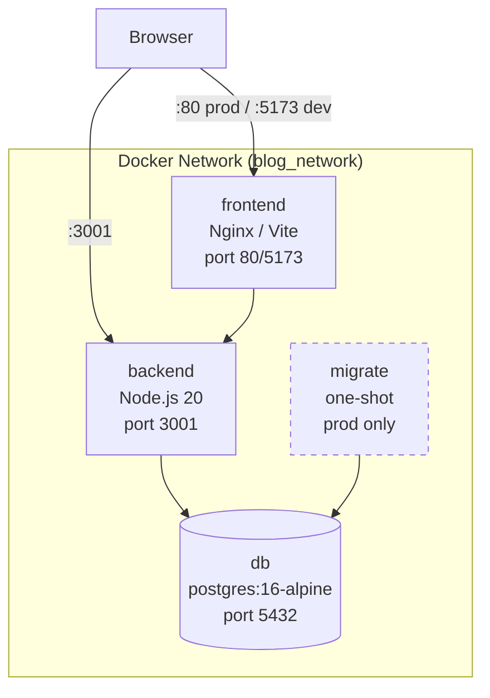
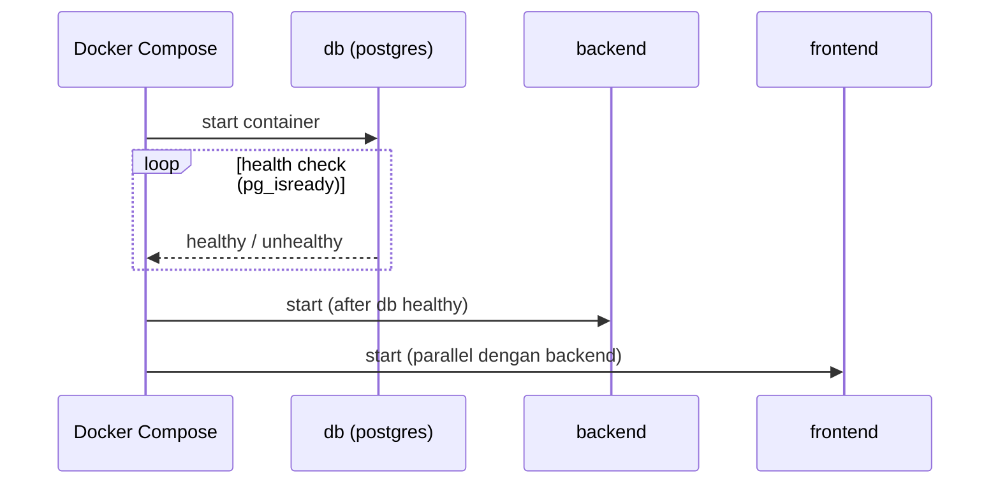
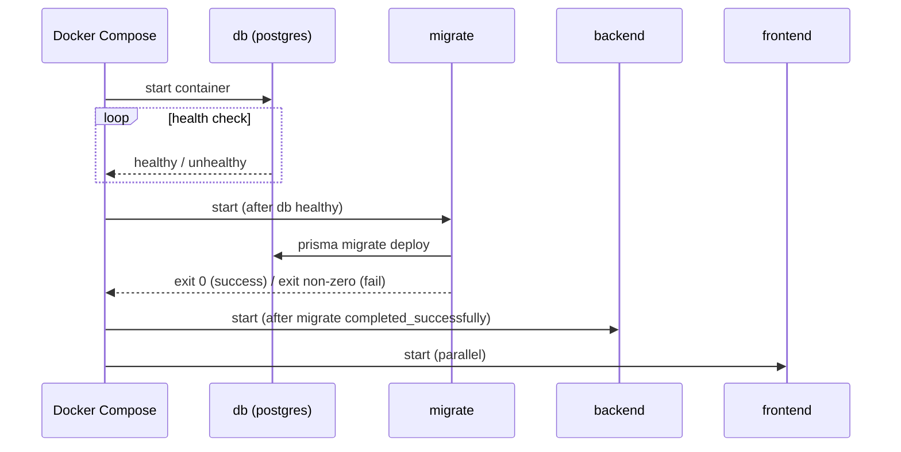

# Design Document

## Docker Integration — Personal Blog Website

---

## Overview

Fitur ini mengkontainerisasi seluruh stack aplikasi (backend Node.js/Express, frontend React/Vite, database PostgreSQL) menggunakan Docker dan Docker Compose. Tujuannya adalah portabilitas penuh: siapapun yang meng-clone repo dapat menjalankan seluruh aplikasi dengan satu perintah tanpa menyiapkan Node.js, PostgreSQL, atau Nginx secara manual.

Dua mode didukung:

- **Development** (`docker-compose.yml`) — bind mount source code, hot-reload via `tsx watch` dan Vite dev server, PostgreSQL port terbuka ke host.
- **Production** (`docker-compose.prod.yml`) — multi-stage builds menghasilkan image minimal, frontend dilayani via Nginx, layanan `migrate` terpisah, DB port tidak terekspos ke luar, semua layanan memiliki restart policy.

### Batasan Desain

- Tidak ada perubahan pada kode aplikasi; semua perubahan terbatas pada file infrastruktur (Dockerfiles, Compose files, config files, dokumentasi).
- `DATABASE_URL` di file `.env` backend harus menggunakan hostname `db` (bukan `localhost`) ketika berjalan di dalam Docker network.
- Secret tidak pernah di-bake ke dalam image; selalu di-inject via `env_file` saat runtime.

---

## Architecture

### Topologi Layanan



### Urutan Startup (Development)



### Urutan Startup (Production)



---

## Components and Interfaces

### File Structure Baru

```
/
├── backend/
│   └── Dockerfile                  # Multi-stage: dev + production
├── frontend/
│   ├── Dockerfile                  # Multi-stage: dev + production
│   └── nginx.conf                  # Konfigurasi Nginx untuk SPA routing
├── docker-compose.yml              # Dev Compose (hot-reload)
├── docker-compose.prod.yml         # Production Compose
├── .env.example                    # Root-level template untuk Docker Compose
└── README.Docker.md                # Dokumentasi setup Docker
```

File yang dimodifikasi:
- `.gitignore` (root) — pastikan `.env` root terdaftar
- `.kiro/steering/tech.md` — tambah seksi perintah Docker

### `backend/Dockerfile`

Menggunakan dua named stages: `dev` untuk development, `builder` + `runner` untuk production.

**Stage `dev`**:
- Base image: `node:20-alpine`
- Install semua dependencies (termasuk devDependencies)
- Expose port 3001
- Default CMD: `npx tsx watch src/server.ts` (hot-reload)
- Source code di-mount via bind mount dari host (tidak di-COPY)

**Stage `builder`** (production build):
- Base image: `node:20-alpine`
- Copy `package*.json` dan `prisma/schema.prisma`
- `npm ci --frozen-lockfile` (semua deps termasuk dev untuk kompilasi)
- Copy source code
- `npx prisma generate` lalu `npm run build` (output ke `dist/`)

**Stage `runner`** (production runtime):
- Base image: `node:20-alpine`
- Copy hanya `dist/` dan `node_modules` production dari `builder`
- Copy `prisma/` directory (diperlukan oleh Prisma Client saat runtime)
- `EXPOSE 3001`
- `CMD ["node", "dist/index.js"]`
- Tidak mengandung source TypeScript maupun devDependencies

### `frontend/Dockerfile`

**Stage `dev`**:
- Base image: `node:20-alpine`
- Install semua dependencies
- `EXPOSE 5173`
- CMD: `npm run dev -- --host 0.0.0.0` (Vite harus listen di semua interface agar host bisa mengakses)

**Stage `builder`** (production build):
- Base image: `node:20-alpine`
- Deklarasikan `ARG VITE_API_URL` — di-pass sebagai build arg
- `ENV VITE_API_URL=$VITE_API_URL` — diperlukan agar Vite meng-embed nilai saat build
- Install dependencies dan jalankan `npm run build` (output ke `dist/`)

**Stage `runner`** (production):
- Base image: `nginx:alpine`
- Copy `dist/` dari `builder` ke `/usr/share/nginx/html`
- Copy `nginx.conf` ke `/etc/nginx/conf.d/default.conf`
- `EXPOSE 80`
- Default CMD nginx (bawaan image)

### `frontend/nginx.conf`

Konfigurasi minimal untuk melayani SPA React dengan client-side routing:

```nginx
server {
    listen 80;
    server_name _;
    root /usr/share/nginx/html;
    index index.html;

    location / {
        try_files $uri $uri/ /index.html;
    }

    # Cache static assets
    location ~* \.(js|css|png|jpg|jpeg|gif|ico|svg|woff|woff2)$ {
        expires 1y;
        add_header Cache-Control "public, immutable";
    }

    # Disable caching for index.html
    location = /index.html {
        add_header Cache-Control "no-store, no-cache, must-revalidate";
    }
}
```

Direktif `try_files $uri $uri/ /index.html` adalah kunci: semua path yang tidak cocok dengan file statis di-fallback ke `index.html`, membiarkan React Router menangani routing.

### `docker-compose.yml` (Development)

**Layanan `db`**:
- Image: `postgres:16-alpine`
- Env vars: `POSTGRES_DB`, `POSTGRES_USER`, `POSTGRES_PASSWORD` via `env_file: ./backend/.env`
- Named volume: `postgres_data:/var/lib/postgresql/data`
- Ports: `5432:5432` (akses langsung dari host untuk tooling)
- Health check: `pg_isready -U $$POSTGRES_USER -d $$POSTGRES_DB`, interval 10s, timeout 5s, retries 5

**Layanan `backend`**:
- Build: `context: ./backend`, `target: dev`
- `env_file: ./backend/.env`
- Bind mount: `./backend/src:/app/src` (hot-reload)
- Bind mount: `./backend/prisma:/app/prisma` (schema changes)
- Ports: `3001:3001`
- `depends_on: db: condition: service_healthy`

**Layanan `frontend`**:
- Build: `context: ./frontend`, `target: dev`
- Bind mount: `./frontend/src:/app/src` (Vite HMR)
- Ports: `5173:5173`
- Environment: `VITE_API_URL=http://localhost:3001` (diakses dari browser host, bukan container network)

**Volume**: `postgres_data` (named, top-level declaration)

### `docker-compose.prod.yml` (Production)

**Layanan `db`**:
- Image: `postgres:16-alpine`
- `env_file: ./backend/.env`
- Named volume: `postgres_data:/var/lib/postgresql/data`
- **Tidak ada** port mapping (tidak terekspos ke luar network)
- Health check: sama dengan dev, retries 8, interval 5s, timeout 5s
- `restart: unless-stopped`
- Network: `blog_network`

**Layanan `migrate`** (one-shot):
- Build: `context: ./backend`, `target: runner`
- `env_file: ./backend/.env`
- Command: `npx prisma migrate deploy`
- `depends_on: db: condition: service_healthy`
- `restart: "no"` (tidak di-restart; gagal = error)
- Network: `blog_network`

**Layanan `backend`**:
- Build: `context: ./backend`, `target: runner`
- `env_file: ./backend/.env`
- Ports: `3001:3001`
- `depends_on: migrate: condition: service_completed_successfully`
- `restart: unless-stopped`
- Network: `blog_network`

**Layanan `frontend`**:
- Build: `context: ./frontend`, `target: runner`
- Build args: `VITE_API_URL=http://localhost:3001` (atau domain produksi)
- Ports: `80:80`
- `restart: unless-stopped`
- Network: `blog_network`

**Network**: `blog_network` (driver: bridge) — layanan hanya dapat berkomunikasi via hostname service name

**Volume**: `postgres_data`

### Root `.env.example`

Template konfigurasi untuk `docker-compose.prod.yml` (referensi tambahan di root):

```env
# Database (digunakan oleh DB_Service dan Backend_Service)
POSTGRES_DB=blog_db
POSTGRES_USER=blog_user
POSTGRES_PASSWORD=change_me_in_production
DATABASE_URL=postgresql://blog_user:change_me_in_production@db:5432/blog_db?schema=public

# JWT
JWT_SECRET=change_me_in_production
JWT_EXPIRES_IN=24h
JWT_USER_EXPIRES_IN=7d

# Admin
ADMIN_USERNAME=admin
ADMIN_PASSWORD_HASH=

# Server
PORT=3001
NODE_ENV=production
```

> **Penting**: Nilai `DATABASE_URL` menggunakan hostname `db` (bukan `localhost`), mengacu pada nama service Docker Compose.

### `.gitignore` Updates

Root `.gitignore` sudah mendaftarkan `.env` — tetapi perlu dipastikan `.env` di root (untuk Compose) juga tercakup. Tambahkan entri eksplisit jika belum ada:

```
# Docker env files
.env
backend/.env
frontend/.env
```

Backend `.gitignore` saat ini mendaftarkan `.env` — tidak ada perubahan diperlukan di sana.

---

## Data Models

Tidak ada model data baru yang diperkenalkan oleh fitur ini. Docker Integration beroperasi sepenuhnya di lapisan infrastruktur. Model Prisma yang ada (`User`, `Post`, `Comment`, `TokenBlacklist`, `LoginAttempts`) dijalankan via `prisma migrate deploy` yang sudah ada.

### Konfigurasi yang Relevan

| Variabel | Dev Value | Prod Value |
|---|---|---|
| `DATABASE_URL` hostname | `localhost` (non-Docker) / `db` (Docker) | `db` |
| `NODE_ENV` | `development` | `production` |
| `VITE_API_URL` | `http://localhost:3001` | URL domain produksi |
| Backend port | 3001 | 3001 |
| Frontend port | 5173 | 80 |
| DB port (ke host) | 5432 | tidak terekspos |

---

## Correctness Properties

Setelah analisis prework terhadap seluruh acceptance criteria, fitur Docker Integration terdiri dari konfigurasi IaC (Dockerfiles, docker-compose YAML, Nginx config), dokumentasi, dan operasi infrastruktur. Seluruh kriteria jatuh ke dalam kategori **SMOKE** (pemeriksaan konfigurasi statis) atau **INTEGRATION** (behavior runtime container) — tidak ada kriteria yang menghasilkan properti universal dengan input yang bervariasi bermakna.

**PBT tidak berlaku untuk fitur ini karena:**
- Seluruh "kode" adalah konfigurasi deklaratif (YAML, Dockerfile, nginx.conf) — bukan fungsi murni dengan input/output
- Tidak ada transformasi data yang perlu diverifikasi properti universalnya
- 100 iterasi tidak akan menemukan bug lebih dari 1-2 pemeriksaan statis
- Tidak ada logika bisnis yang ditulis dalam bahasa pemrograman sebagai bagian dari fitur ini

Properti-properti di bawah ini bukan property-based tests, melainkan **invariant struktural** yang diverifikasi via smoke tests (inspeksi file konfigurasi statis).

### Property 1: DB health check must precede backend startup

Dalam konfigurasi Compose mana pun (dev maupun prod), service `backend` wajib memiliki `depends_on` yang menyertakan `db` dengan `condition: service_healthy`. Invariant ini berlaku tanpa pengecualian — tidak boleh ada konfigurasi di mana backend dapat dimulai sebelum database dinyatakan healthy.

**Validates: Requirements 1.7, 3.5**

### Property 2: No secrets baked into image layers

Untuk setiap image backend maupun frontend yang di-build, tidak boleh ada environment variable yang mengandung nilai secret aktual (`JWT_SECRET`, `DATABASE_URL` dengan kredensial, `POSTGRES_PASSWORD`) yang tertanam di layer image (terlihat via `docker history` atau `docker inspect` pada image config). Secret hanya boleh di-inject saat runtime melalui `env_file`.

**Validates: Requirements 1.5, 6.2**

### Property 3: Migration ordering in production

Dalam `docker-compose.prod.yml`, service `migrate` wajib selalu menyelesaikan eksekusinya dengan sukses (exit 0) sebelum service `backend` dimulai. Ini direpresentasikan oleh kondisi `service_completed_successfully` pada `depends_on` backend. Tidak boleh ada jalur startup production di mana backend berjalan tanpa migrasi yang telah selesai.

**Validates: Requirements 4.7, 5.2**

### Property 4: Production DB port isolation

Dalam `docker-compose.prod.yml`, service `db` tidak boleh mendeklarasikan mapping `ports` apa pun. Port 5432 hanya dapat diakses dari dalam `blog_network` (oleh service `backend` dan `migrate`), dan tidak dapat dijangkau dari network host.

**Validates: Requirements 4.5, 6.6**

Strategi pengujian yang tepat dijabarkan di seksi Testing Strategy.

---

## Error Handling

### Kegagalan Health Check Database

Jika `db` service tidak mencapai status `healthy` dalam waktu yang dikonfigurasi, Docker Compose menghentikan startup dan melaporkan error. Tidak ada retry otomatis di level Compose — operator harus memeriksa log `db` service.

Pesan kegagalan yang diharapkan:
```
dependency failed to start: container db is unhealthy
```

### Kegagalan Migration (Production)

Layanan `migrate` menjalankan `npx prisma migrate deploy`. Jika migration gagal (koneksi DB error, conflict schema), Prisma keluar dengan exit code non-zero. Docker Compose mendeteksi ini dan tidak memulai `backend` service (karena `service_completed_successfully`).

Operator perlu memeriksa log:
```bash
docker compose -f docker-compose.prod.yml logs migrate
```

### Variabel Environment Tidak Terdefinisi

Jika `DATABASE_URL`, `JWT_SECRET`, atau `POSTGRES_PASSWORD` tidak ada di file `.env`:
- `db` service akan gagal inisialisasi (PostgreSQL menolak start tanpa `POSTGRES_PASSWORD`)
- `backend` service akan gagal startup (Prisma melempar error koneksi, Express gagal bind)
- Error akan terlihat di `docker compose logs <service>`

Pencegahan: file `.env.example` menyediakan template dengan semua variabel yang diperlukan dengan nilai placeholder yang jelas.

### Vite Dev Server di Container

Vite harus di-start dengan flag `--host 0.0.0.0` agar dapat diakses dari browser di host. Tanpa flag ini, Vite hanya listen di `127.0.0.1` di dalam container dan tidak dapat dijangkau.

### VITE_API_URL di Production

`VITE_API_URL` harus menunjuk ke URL yang dapat dijangkau oleh browser pengguna (bukan nama service Docker internal). Jika disetel ke `http://backend:3001`, browser akan gagal melakukan request karena `backend` bukan nama yang bisa diresolusi dari luar Docker network. Nilai default yang aman: `http://localhost:3001` untuk deployment single-host.

---

## Testing Strategy

Karena fitur ini adalah IaC murni, strategi pengujian berbasis pada **smoke tests** dan **integration tests**, bukan property-based tests.

### Smoke Tests (Verifikasi Konfigurasi Statis)

Smoke test memverifikasi bahwa file konfigurasi memiliki struktur yang benar tanpa menjalankan container. Dapat dijalankan di CI tanpa Docker daemon.

| Test | Yang Diverifikasi |
|---|---|
| `backend/Dockerfile` ada dan berisi stage `dev`, `builder`, `runner` | Requirement 1.1, 1.2 |
| Stage `runner` menggunakan `node:20-alpine` dan `CMD ["node", "dist/index.js"]` | Requirement 1.3, 1.4 |
| `EXPOSE 3001` ada di backend Dockerfile | Requirement 1.6 |
| Tidak ada `ENV JWT_SECRET` atau `ENV DATABASE_URL` dengan nilai aktual di Dockerfile | Requirement 1.5 |
| `frontend/Dockerfile` berisi stage `dev`, `builder`, `runner` | Requirement 2.1, 2.2 |
| `ARG VITE_API_URL` ada di frontend Dockerfile | Requirement 2.6 |
| `EXPOSE 80` di runner stage, `EXPOSE 5173` di dev stage | Requirement 2.4, 2.5 |
| `frontend/nginx.conf` berisi `try_files $uri $uri/ /index.html` | Requirement 2.3 |
| `docker-compose.yml` mendefinisikan service `db`, `backend`, `frontend` | Requirement 3.1 |
| `depends_on.db.condition: service_healthy` ada di backend service | Requirement 3.5, 1.7 |
| `env_file` dikonfigurasi untuk semua layanan | Requirement 3.6 |
| Health check `db` (dev): retries=5, interval=10s, timeout=5s | Requirement 3.9 |
| `docker-compose.prod.yml` mendefinisikan service `migrate` | Requirement 4.7 |
| DB service di prod tidak memiliki `ports` | Requirement 4.5 |
| `restart: unless-stopped` pada semua layanan prod | Requirement 4.6 |
| Health check `db` (prod): retries=8, interval=5s | Requirement 1.8 |
| Named network `blog_network` terdefinisi di prod Compose | Requirement 6.6 |
| `.env` terdaftar di root `.gitignore` | Requirement 6.2 |
| `backend/.env` terdaftar di `backend/.gitignore` | Requirement 6.2 |

### Integration Tests (Verifikasi Runtime)

Integration test memerlukan Docker daemon yang berjalan. Direkomendasikan dijalankan di CI environment dengan Docker-in-Docker atau di mesin lokal.

| Test | Yang Diverifikasi |
|---|---|
| `docker compose up -d db && docker compose ps db` menunjukkan status healthy | Requirement 3.2 |
| `docker compose up` berhasil start semua 3 layanan | Requirement 3.1 |
| `curl http://localhost:3001/health` dari host mengembalikan 200 setelah stack up | Requirement 3.8 |
| `curl http://localhost:5173` mengembalikan HTML index | Requirement 3.8 |
| `docker compose -f docker-compose.prod.yml up` berhasil menjalankan migrate lalu backend | Requirement 4.7, 5.2 |
| Prod DB service tidak accessible dari `localhost:5432` setelah stack up | Requirement 4.5 |
| Backend di prod menggunakan compiled JS (tidak ada `tsx` di process list) | Requirement 4.2 |
| Hot-reload: modifikasi file di `./backend/src` merestart backend process dalam container | Requirement 3.3 |

### Unit Tests

Tidak ada unit test yang ditulis sebagai bagian dari fitur ini — tidak ada logika bisnis baru yang ditambahkan ke kodebase aplikasi.

### Panduan Pengujian Manual

Langkah verifikasi end-to-end yang direkomendasikan setelah implementasi:

```bash
# 1. Verifikasi dev stack
docker compose up -d
docker compose ps        # semua service harus Running
curl http://localhost:3001/api/posts   # harus return JSON
open http://localhost:5173             # harus render React app

# 2. Verifikasi hot-reload backend
# Edit backend/src/routes/post.routes.ts → simpan → perhatikan container log restart

# 3. Verifikasi prod stack
cp backend/.env.example backend/.env  # isi nilai yang valid
cp .env.example .env
docker compose -f docker-compose.prod.yml up -d --build
curl http://localhost:3001/api/posts
open http://localhost:80

# 4. Verifikasi keamanan
docker inspect blog_backend | grep -i jwt_secret   # tidak boleh ada nilai aktual
docker history blog_backend --no-trunc | grep ENV  # tidak boleh ada secret
```
