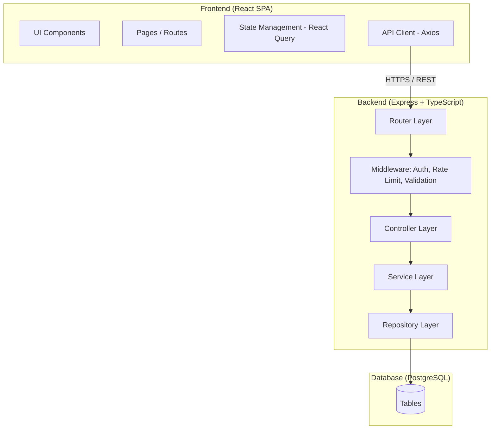
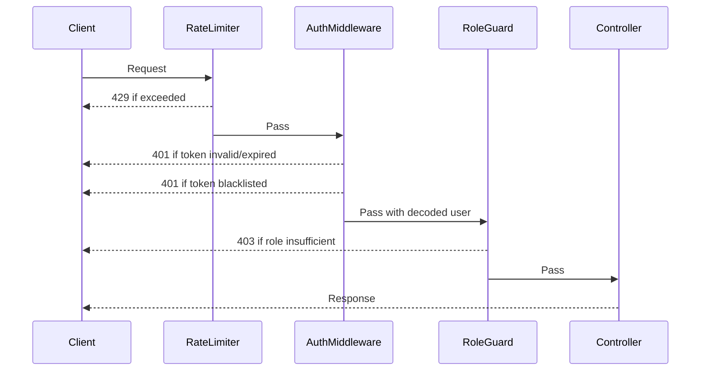
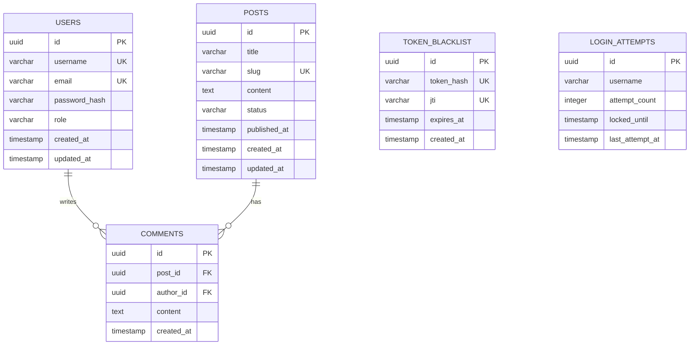
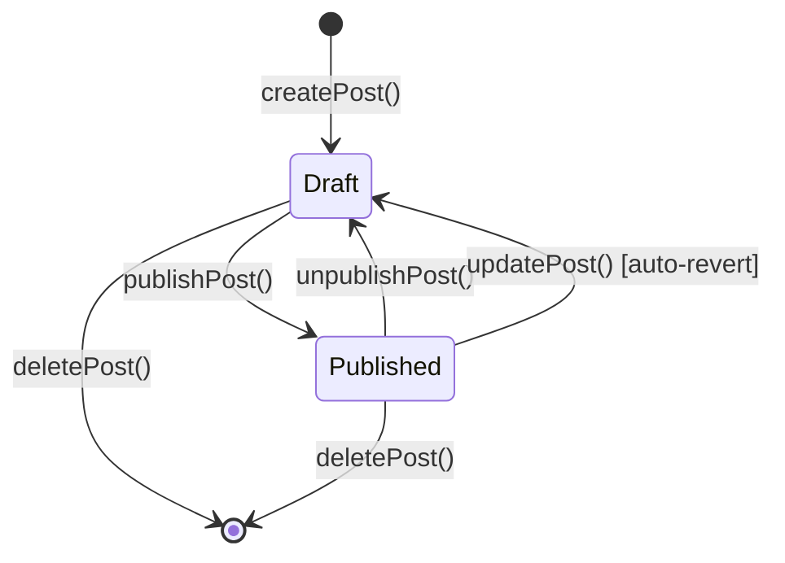
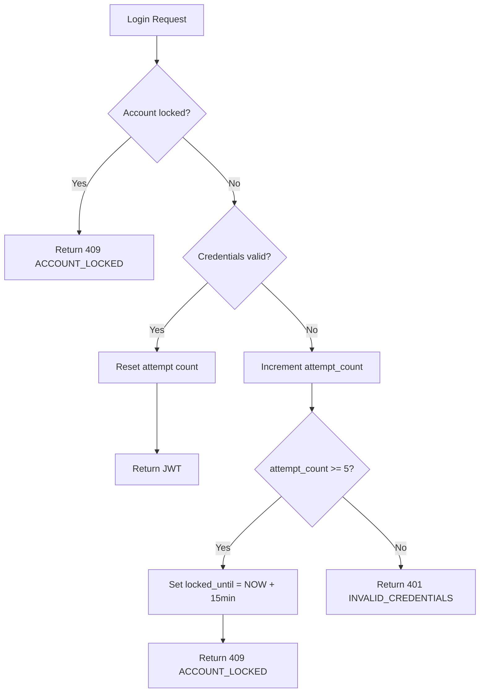

# Design Document: Personal Blog Website

## Overview

Personal Blog Website adalah aplikasi web full-stack yang dibangun dengan arsitektur client-server tradisional. Backend berupa REST API berbasis Node.js/Express dengan TypeScript, sedangkan frontend adalah Single Page Application (SPA) menggunakan React dan Tailwind CSS, dengan PostgreSQL sebagai penyimpanan data utama.

Sistem mendukung tiga peran pengguna:
- **Visitor** – membaca postingan dan komentar tanpa autentikasi
- **Registered_User** – Visitor yang telah login, dapat memberikan komentar
- **Admin** – satu akun tetap dengan akses penuh untuk mengelola postingan dan komentar

Autentikasi menggunakan JWT stateless dengan mekanisme blacklist untuk mendukung invalidasi token saat logout.

---

## Architecture

Aplikasi mengikuti **layered architecture** dengan pemisahan yang jelas antara lapisan presentasi, logika bisnis, dan akses data.



### Keputusan Arsitektur

| Keputusan | Pilihan | Alasan |
|-----------|---------|--------|
| API Style | REST | Sederhana, sesuai untuk blog CRUD |
| Auth | JWT + Blacklist Table | Stateless dengan dukungan logout yang proper |
| Password Hashing | bcrypt (cost 12) | OWASP-recommended, mature, battle-tested |
| Rate Limiting | express-rate-limit (IP) + in-memory per-account lockout | Melindungi dari brute-force di level IP maupun akun |
| ORM | Prisma | Type-safe, migration support, PostgreSQL-first |
| Markdown | `marked` (server render) + `react-markdown` (client preview) | Konsisten antara preview dan render final |
| Slug | `slugify` + suffix numerik | Menghasilkan URL-friendly string yang unik |
| Pagination | Offset-based | Sederhana untuk blog dengan volume konten rendah-menengah |
| Theme | CSS Custom Properties (Tailwind v4) | Konsisten dengan design system, dark mode out-of-the-box |
| Font | Computer Modern (CMU Serif) via @font-face | Tampilan akademik/literary yang sesuai untuk blog tulisan |

---

## Visual Design

### Design System

Tampilan menggunakan **Tailwind CSS v4** dengan token warna berbasis CSS custom properties. Tema mendukung **light mode** dan **dark mode** via kelas `.dark` pada elemen `<html>`.

**Palet warna utama:**

| Token | Light | Dark | Penggunaan |
|-------|-------|------|-----------|
| `--background` | `#dfe8f1` | `#293d61` | Background halaman |
| `--foreground` | `#000000` | `#fafafa` | Teks utama |
| `--card` | `#d8e6f3` | `#385579` | Card/panel komponen |
| `--primary` | `#bb6588` | `#bb6588` | Tombol utama, aksen |
| `--secondary` | `#ccaa87` | `#ccaa87` | Tombol sekunder |
| `--accent` | `#bda5ad` | `#bda5ad` | Hover state, highlight |
| `--border` | `#c0cae7` | `#1c2641` | Border komponen |
| `--muted` | `#d8e6f3` | `#385579` | Background muted/subtle |
| `--destructive` | `#e7000b` | `#ff6467` | Tombol hapus, pesan error |

**Border radius:** `--radius: 0.8rem` — `sm: calc(radius - 4px)`, `md: calc(radius - 2px)`, `lg: radius`, `xl: calc(radius + 4px)`.

**Tipografi:** **Computer Modern** (CMU Serif) — memberikan nuansa akademik dan literary yang sesuai untuk blog tulisan. Diload via `@font-face` menggunakan file WOFF2 yang ditempatkan di `frontend/public/fonts/`.

### Theme CSS (`frontend/src/index.css`)

File ini adalah sumber kebenaran tunggal untuk seluruh design token dan konfigurasi tema:

```css
@import "tailwindcss";

@custom-variant dark (&:is(.dark *));

/* ── Computer Modern font ── */
@font-face {
  font-family: 'Computer Modern';
  src: url('/fonts/cmunrm.woff2') format('woff2');
  font-weight: normal;
  font-style: normal;
  font-display: swap;
}
@font-face {
  font-family: 'Computer Modern';
  src: url('/fonts/cmunbx.woff2') format('woff2');
  font-weight: bold;
  font-style: normal;
  font-display: swap;
}
@font-face {
  font-family: 'Computer Modern';
  src: url('/fonts/cmunti.woff2') format('woff2');
  font-weight: normal;
  font-style: italic;
  font-display: swap;
}
@font-face {
  font-family: 'Computer Modern';
  src: url('/fonts/cmunbi.woff2') format('woff2');
  font-weight: bold;
  font-style: italic;
  font-display: swap;
}

/* ── Light mode tokens ── */
:root {
  --background: #dfe8f1;
  --foreground: #000000;
  --card: #d8e6f3;
  --card-foreground: #0a0a0a;
  --popover: #dfe8f1;
  --popover-foreground: #0a0a0a;
  --primary: #bb6588;
  --primary-foreground: #fafafa;
  --secondary: #ccaa87;
  --secondary-foreground: #fafafa;
  --muted: #d8e6f3;
  --muted-foreground: #737373;
  --accent: #bda5ad;
  --accent-foreground: #fafafa;
  --destructive: #e7000b;
  --destructive-foreground: #ffffff;
  --border: #c0cae7;
  --input: #a0b3d9;
  --ring: #bb6588;
  --radius: 0.8rem;
  --shadow-sm: 0 1px 0px 0px hsl(0 0% 0% / 0.05), 0 1px 2px -1px hsl(0 0% 0% / 0.05);
  --shadow-md: 0 1px 0px 0px hsl(0 0% 0% / 0.05), 0 2px 4px -1px hsl(0 0% 0% / 0.05);
  --shadow-lg: 0 1px 0px 0px hsl(0 0% 0% / 0.05), 0 4px 6px -1px hsl(0 0% 0% / 0.05);
}

/* ── Dark mode tokens ── */
.dark {
  --background: #293d61;
  --foreground: #fafafa;
  --card: #385579;
  --card-foreground: #fafafa;
  --popover: #293d61;
  --popover-foreground: #fafafa;
  --primary: #bb6588;
  --primary-foreground: #fafafa;
  --secondary: #ccaa87;
  --secondary-foreground: #fafafa;
  --muted: #385579;
  --muted-foreground: #9fb8d2;
  --accent: #bda5ad;
  --accent-foreground: #fafafa;
  --destructive: #ff6467;
  --destructive-foreground: #fafafa;
  --border: #1c2641;
  --input: #223760;
  --ring: #bb6588;
}

/* ── Tailwind v4 theme mapping ── */
@theme inline {
  --color-background: var(--background);
  --color-foreground: var(--foreground);
  --color-card: var(--card);
  --color-card-foreground: var(--card-foreground);
  --color-popover: var(--popover);
  --color-popover-foreground: var(--popover-foreground);
  --color-primary: var(--primary);
  --color-primary-foreground: var(--primary-foreground);
  --color-secondary: var(--secondary);
  --color-secondary-foreground: var(--secondary-foreground);
  --color-muted: var(--muted);
  --color-muted-foreground: var(--muted-foreground);
  --color-accent: var(--accent);
  --color-accent-foreground: var(--accent-foreground);
  --color-destructive: var(--destructive);
  --color-destructive-foreground: var(--destructive-foreground);
  --color-border: var(--border);
  --color-input: var(--input);
  --color-ring: var(--ring);
  --font-sans: 'Computer Modern', ui-serif, Georgia, Cambria, serif;
  --font-serif: 'Computer Modern', ui-serif, Georgia, Cambria, serif;
  --font-mono: ui-monospace, SFMono-Regular, Menlo, Monaco, Consolas, monospace;
  --radius-sm: calc(var(--radius) - 4px);
  --radius-md: calc(var(--radius) - 2px);
  --radius-lg: var(--radius);
  --radius-xl: calc(var(--radius) + 4px);
  --shadow-sm: var(--shadow-sm);
  --shadow-md: var(--shadow-md);
  --shadow-lg: var(--shadow-lg);
}

@layer base {
  * {
    @apply border-border outline-ring/50;
  }
  body {
    @apply bg-background text-foreground;
    font-family: 'Computer Modern', ui-serif, Georgia, serif;
  }
}
```

### Font Setup

Unduh **Computer Modern Unicode (CMU)** font files dan tempatkan di `frontend/public/fonts/`:

| File | Variant |
|------|---------|
| `cmunrm.woff2` | CMU Serif Roman (regular) |
| `cmunbx.woff2` | CMU Serif Bold |
| `cmunti.woff2` | CMU Serif Italic |
| `cmunbi.woff2` | CMU Serif Bold Italic |

Sumber font: [https://checkmyworking.com/cm-web-fonts/](https://checkmyworking.com/cm-web-fonts/) — unduh dan konversi ke WOFF2 menggunakan `woff2_compress`, atau gunakan versi yang sudah dalam format WOFF2 dari repositori font CMU yang tersedia di GitHub.

### Dark Mode Toggle

- State dark mode disimpan di `localStorage` dengan key `theme` (`'dark'` | `'light'`)
- Toggle dilakukan dengan menambah/menghapus kelas `.dark` pada elemen `<html>`
- Implementasi via `useTheme` hook di `frontend/src/hooks/useTheme.ts`
- Script inlining di `index.html` mencegah **flash of unstyled content (FOUC)** saat halaman dimuat
- Tombol toggle (ikon matahari/bulan) ditempatkan di `Navbar`


## Components and Interfaces

### Backend Components

#### 1. Auth Router (`/api/auth`)

| Method | Path | Deskripsi | Auth Required |
|--------|------|-----------|---------------|
| POST | `/register` | Registrasi Registered_User baru | No |
| POST | `/login` | Login Admin atau Registered_User | No |
| POST | `/logout` | Invalidasi JWT aktif | Yes (any role) |

#### 2. Post Router (`/api/posts`)

| Method | Path | Deskripsi | Auth Required |
|--------|------|-----------|---------------|
| GET | `/` | Daftar post Published (publik, paginated) | No |
| GET | `/admin` | Daftar semua post (Draft + Published) | Admin |
| GET | `/search` | Cari post Published berdasarkan keyword | No |
| GET | `/:slug` | Detail post Published | No |
| POST | `/` | Buat post baru | Admin |
| PUT | `/:id` | Edit post | Admin |
| PATCH | `/:id/publish` | Ubah status menjadi Published | Admin |
| PATCH | `/:id/unpublish` | Ubah status menjadi Draft | Admin |
| DELETE | `/:id` | Hapus post beserta komentar | Admin |

#### 3. Comment Router (`/api/posts/:postId/comments`)

| Method | Path | Deskripsi | Auth Required |
|--------|------|-----------|---------------|
| GET | `/` | Daftar komentar pada post Published | No |
| POST | `/` | Tambah komentar baru | Registered_User |
| DELETE | `/:commentId` | Hapus komentar | Owner atau Admin |

#### 4. User Router (`/api/users`)

| Method | Path | Deskripsi | Auth Required |
|--------|------|-----------|---------------|
| GET | `/me` | Lihat profil sendiri | Registered_User |
| PATCH | `/me/username` | Update username | Registered_User |
| PATCH | `/me/password` | Update password | Registered_User |

### Middleware Stack



#### `authenticateJWT`
Memverifikasi JWT dari header `Authorization: Bearer <token>`. Memeriksa blacklist table. Mengisi `req.user` dengan payload yang telah didekode.

#### `requireRole(role: 'admin' | 'user')`
Middleware factory yang memeriksa `req.user.role`. Mengembalikan 403 jika peran tidak sesuai.

#### `loginRateLimiter`
Menggunakan `express-rate-limit`: max 10 requests per IP per 60 detik pada endpoint `/auth/login` dan `/auth/register`.

#### `accountLockoutMiddleware`
Melacak percobaan login gagal per username di in-memory store (atau Redis untuk production). Setelah 5 kali gagal berturut-turut, akun dikunci selama 15 menit.

#### `validateBody(schema: ZodSchema)`
Middleware factory yang memvalidasi `req.body` terhadap schema Zod. Mengembalikan 400 dengan detail error jika validasi gagal.

### Frontend Components

```
src/
├── api/           # Axios instance + API call functions
├── components/
│   ├── ui/        # Reusable: Button, Input, Badge, Pagination
│   ├── layout/    # Navbar, Footer, Layout wrapper
│   ├── blog/      # PostCard, PostList, CommentList, CommentForm
│   └── admin/     # PostEditor, PostTable, StatusBadge
├── pages/
│   ├── public/    # HomePage, PostDetailPage, SearchPage
│   ├── auth/      # LoginPage, RegisterPage
│   ├── admin/     # DashboardPage, CreatePostPage, EditPostPage
│   └── user/      # ProfilePage
├── hooks/         # useAuth, usePosts, useComments, useProfile
├── contexts/      # AuthContext
└── types/         # Shared TypeScript interfaces
```

#### Key Frontend Interfaces

```typescript
interface Post {
  id: string;
  title: string;
  slug: string;
  content: string;          // raw Markdown
  contentHtml: string;      // rendered HTML (from server)
  status: 'draft' | 'published';
  publishedAt: string | null;
  updatedAt: string;
  commentCount: number;
}

interface Comment {
  id: string;
  postId: string;
  authorId: string;
  authorUsername: string;
  content: string;
  createdAt: string;
}

interface User {
  id: string;
  username: string;
  email: string;
  role: 'admin' | 'user';
  joinedAt: string;
}

interface AuthState {
  user: User | null;
  token: string | null;
  isLoading: boolean;
}

interface PaginatedResponse<T> {
  data: T[];
  total: number;
  page: number;
  pageSize: number;
  totalPages: number;
}
```

---

## Data Models

### Entity Relationship Diagram



### PostgreSQL Table Definitions

#### `users`
```sql
CREATE TABLE users (
  id            UUID PRIMARY KEY DEFAULT gen_random_uuid(),
  username      VARCHAR(50)  NOT NULL UNIQUE,
  email         VARCHAR(255) NOT NULL UNIQUE,
  password_hash VARCHAR(255) NOT NULL,
  role          VARCHAR(10)  NOT NULL CHECK (role IN ('admin', 'user')),
  created_at    TIMESTAMPTZ  NOT NULL DEFAULT NOW(),
  updated_at    TIMESTAMPTZ  NOT NULL DEFAULT NOW()
);
```

#### `posts`
```sql
CREATE TABLE posts (
  id           UUID PRIMARY KEY DEFAULT gen_random_uuid(),
  title        VARCHAR(200) NOT NULL,
  slug         VARCHAR(220) NOT NULL UNIQUE,
  content      TEXT         NOT NULL,
  status       VARCHAR(10)  NOT NULL DEFAULT 'draft' CHECK (status IN ('draft', 'published')),
  published_at TIMESTAMPTZ,
  created_at   TIMESTAMPTZ  NOT NULL DEFAULT NOW(),
  updated_at   TIMESTAMPTZ  NOT NULL DEFAULT NOW()
);

CREATE INDEX idx_posts_status_published_at ON posts(status, published_at DESC);
CREATE INDEX idx_posts_slug ON posts(slug);
CREATE INDEX idx_posts_updated_at ON posts(updated_at DESC);
CREATE INDEX idx_posts_search ON posts USING gin(to_tsvector('indonesian', title || ' ' || content));
```

#### `comments`
```sql
CREATE TABLE comments (
  id         UUID PRIMARY KEY DEFAULT gen_random_uuid(),
  post_id    UUID         NOT NULL REFERENCES posts(id) ON DELETE CASCADE,
  author_id  UUID         NOT NULL REFERENCES users(id) ON DELETE CASCADE,
  content    TEXT         NOT NULL CHECK (char_length(content) BETWEEN 1 AND 2000),
  created_at TIMESTAMPTZ  NOT NULL DEFAULT NOW()
);

CREATE INDEX idx_comments_post_id ON comments(post_id, created_at ASC);
```

#### `token_blacklist`
```sql
CREATE TABLE token_blacklist (
  id          UUID PRIMARY KEY DEFAULT gen_random_uuid(),
  token_hash  VARCHAR(64) NOT NULL UNIQUE,
  jti         VARCHAR(36) NOT NULL UNIQUE,
  expires_at  TIMESTAMPTZ NOT NULL,
  created_at  TIMESTAMPTZ NOT NULL DEFAULT NOW()
);

CREATE INDEX idx_token_blacklist_expires_at ON token_blacklist(expires_at);
```

**Catatan**: Token yang sudah lewat `expires_at` dibersihkan secara periodik (cronjob) sehingga tabel tidak tumbuh tak terbatas.

#### `login_attempts`
```sql
CREATE TABLE login_attempts (
  id              UUID PRIMARY KEY DEFAULT gen_random_uuid(),
  username        VARCHAR(100) NOT NULL UNIQUE,
  attempt_count   INTEGER      NOT NULL DEFAULT 0,
  locked_until    TIMESTAMPTZ,
  last_attempt_at TIMESTAMPTZ  NOT NULL DEFAULT NOW()
);

CREATE INDEX idx_login_attempts_username ON login_attempts(username);
```

### Service Layer Interfaces

```typescript
// AuthService
interface AuthService {
  registerUser(data: RegisterDto): Promise<UserProfile>;
  loginAdmin(credentials: LoginDto): Promise<AuthTokens>;
  loginUser(credentials: LoginDto): Promise<AuthTokens>;
  logout(token: string, jti: string): Promise<void>;
  validateToken(token: string): Promise<JwtPayload>;
  isTokenBlacklisted(jti: string): Promise<boolean>;
  recordFailedAttempt(username: string): Promise<void>;
  checkAccountLockout(username: string): Promise<LockoutStatus>;
}

// PostService
interface PostService {
  createPost(data: CreatePostDto): Promise<Post>;
  updatePost(id: string, data: UpdatePostDto): Promise<Post>;
  publishPost(id: string): Promise<Post>;
  unpublishPost(id: string): Promise<Post>;
  deletePost(id: string): Promise<void>;
  getPublishedPosts(page: number, pageSize: number): Promise<PaginatedResponse<PostSummary>>;
  getAllPosts(page: number, pageSize: number): Promise<PaginatedResponse<Post>>;
  getPostBySlug(slug: string): Promise<Post>;
  searchPosts(keyword: string, page: number): Promise<PaginatedResponse<PostSummary>>;
  generateUniqueSlug(title: string): Promise<string>;
}

// CommentService
interface CommentService {
  addComment(postId: string, authorId: string, content: string): Promise<Comment>;
  deleteComment(commentId: string, requesterId: string, requesterRole: string): Promise<void>;
  getCommentsByPost(postId: string): Promise<Comment[]>;
}

// UserService
interface UserService {
  getProfile(userId: string): Promise<UserProfile>;
  updateUsername(userId: string, newUsername: string): Promise<UserProfile>;
  updatePassword(userId: string, oldPassword: string, newPassword: string): Promise<void>;
}
```

### Post Status State Machine



**Aturan transisi**:
- `Draft → Published`: hanya via `publishPost()`
- `Published → Draft`: via `unpublishPost()` eksplisit ATAU via `updatePost()` (auto-revert)
- Mencoba publish post yang sudah Published → error 409
- Mencoba unpublish post yang sudah Draft → error 409

---

## Correctness Properties

*A property is a characteristic or behavior that should hold true across all valid executions of a system — essentially, a formal statement about what the system should do. Properties serve as the bridge between human-readable specifications and machine-verifiable correctness guarantees.*

### Property 1: Slug uniqueness after generation

*For any* set of posts in the database and any new post title, the slug generated for the new post SHALL be unique and not collide with any existing slug in the database.

**Validates: Requirements 3.1, 3.2**

---

### Property 2: Slug regeneration on title change

*For any* existing post with a given slug, when the post title is updated to a different value, the system SHALL generate a new unique slug derived from the new title.

**Validates: Requirements 3.3**

---

### Property 3: Published post auto-reverts to Draft on edit

*For any* post with status Published, when the content or title is updated via `updatePost()`, the resulting post SHALL have status Draft.

**Validates: Requirements 3.4**

---

### Property 4: Status transition validity

*For any* post, attempting to transition it to its current status (publish an already-Published post, or unpublish an already-Draft post) SHALL result in an error response, and the post status SHALL remain unchanged.

**Validates: Requirements 4.6**

---

### Property 5: Post deletion cascades to comments

*For any* post with one or more comments, when the post is deleted, all associated comments SHALL also be permanently removed from the database.

**Validates: Requirements 4.3**

---

### Property 6: Public endpoint returns only Published posts

*For any* query to the public post listing or search endpoint, all posts in the response SHALL have status Published; no Draft posts SHALL appear.

**Validates: Requirements 4.7, 5.1, 5.5**

---

### Property 7: Comment ownership enforcement

*For any* delete comment request, the deletion SHALL succeed only if the requester is the comment's author OR has the `admin` role; all other requesters SHALL receive a 403 error.

**Validates: Requirements 6.3, 6.4, 6.5**

---

### Property 8: Comment content validation

*For any* comment submission, the comment SHALL be stored if and only if the content is between 1 and 2000 characters (non-empty, non-exceeding limit); all other submissions SHALL be rejected with a validation error.

**Validates: Requirements 6.1, 6.7**

---

### Property 9: JWT blacklist prevents reuse after logout

*For any* JWT that has been invalidated via logout, subsequent requests using that same token SHALL be rejected with a 401 error.

**Validates: Requirements 1.6**

---

### Property 10: Role claim enforces endpoint access

*For any* request to an admin-only endpoint, the request SHALL be granted if and only if the JWT payload contains `role: "admin"`; all other role values or missing claims SHALL result in a 403 error.

**Validates: Requirements 7.1, 7.2, 7.3**

---

### Property 11: Username uniqueness on update

*For any* username update request, the update SHALL succeed if and only if the new username is not already used by another account; duplicate usernames SHALL result in a 409 error and the username SHALL remain unchanged.

**Validates: Requirements 8.2, 8.3**

---

### Property 12: Password change requires correct current password

*For any* password change request, the update SHALL succeed if and only if the provided current password correctly matches the stored hash; incorrect current password SHALL result in an error and the password SHALL remain unchanged.

**Validates: Requirements 8.4, 8.5**

---

### Property 13: Search returns only matching Published posts

*For any* non-empty keyword search, every post in the result set SHALL be Published AND SHALL contain the keyword in its title or content; no Draft posts and no non-matching posts SHALL appear.

**Validates: Requirements 5.5**

---

## Error Handling

### HTTP Status Code Convention

| Status | Penggunaan |
|--------|-----------|
| 200 | Sukses (GET, PUT, PATCH) |
| 201 | Resource baru berhasil dibuat (POST) |
| 204 | Sukses tanpa body (DELETE) |
| 400 | Validasi input gagal |
| 401 | Token tidak ada, tidak valid, atau kedaluwarsa |
| 403 | Token valid tapi role tidak memiliki izin |
| 404 | Resource tidak ditemukan |
| 409 | Konflik: duplicate (email/username/slug) atau transisi status tidak valid |
| 429 | Rate limit terlampaui |
| 500 | Internal server error |

### Error Response Format

Semua error API dikembalikan dalam format yang konsisten:

```typescript
interface ErrorResponse {
  error: {
    code: string;       // machine-readable error code, e.g. "VALIDATION_ERROR"
    message: string;    // human-readable message
    fields?: Record<string, string>; // field-level errors untuk validasi
  };
}
```

**Contoh**:
```json
// 400 Validation Error
{
  "error": {
    "code": "VALIDATION_ERROR",
    "message": "Input validation failed",
    "fields": {
      "title": "Title is required",
      "content": "Content cannot be empty"
    }
  }
}

// 401 Unauthorized
{
  "error": {
    "code": "UNAUTHORIZED",
    "message": "Authentication required"
  }
}

// 409 Conflict (login attempt)
{
  "error": {
    "code": "ACCOUNT_LOCKED",
    "message": "Account temporarily locked. Try again in 15 minutes."
  }
}
```

### Security-Sensitive Error Handling

- **Login gagal** (Req 1.3, 2.5): Selalu kembalikan pesan generik yang sama ("Invalid credentials") baik username maupun password salah — mencegah user enumeration.
- **Admin login invalid** (Req 1.3): Tidak mengungkapkan field mana yang salah.
- **Draft post diakses Visitor** (Req 4.7): Kembalikan 404, bukan 403 — tidak mengungkapkan keberadaan konten tersebut.

### Account Lockout Flow



### Frontend Error Handling

- Axios interceptor menangkap 401 → clear auth state → redirect ke `/login`
- Axios interceptor menangkap 429 → tampilkan pesan "Too many requests, please wait"
- Form validasi dilakukan di sisi klien (Zod schema) sebelum request dikirim
- Error 500 menampilkan halaman error generic tanpa detail teknis

---

## Testing Strategy

### Pendekatan Dual Testing

Strategi pengujian menggunakan dua lapisan yang saling melengkapi:

1. **Unit tests** – menguji logika bisnis terisolasi dengan mock dependencies
2. **Property-based tests** – memverifikasi properti universal di berbagai input acak
3. **Integration tests** – menguji interaksi antar komponen dengan database nyata (test DB)
4. **E2E tests** – menguji alur pengguna dari browser ke database

### Tech Stack Testing

| Layer | Library |
|-------|---------|
| Unit + Property (Backend) | Vitest + fast-check |
| Integration (Backend) | Vitest + Supertest + test PostgreSQL |
| Unit (Frontend) | Vitest + React Testing Library |
| E2E | Playwright |

### Property-Based Tests

Setiap property test menggunakan **fast-check** dengan minimum **100 iterasi**. Setiap test diberi tag yang mereferensikan design property.

```typescript
// Tag format: Feature: personal-blog-website, Property {N}: {property_text}

// Property 1: Slug uniqueness
it('generates unique slugs for any title given existing posts', () => {
  // Feature: personal-blog-website, Property 1: Slug uniqueness after generation
  fc.assert(fc.asyncProperty(
    fc.array(fc.string({ minLength: 1, maxLength: 200 })),
    fc.string({ minLength: 1, maxLength: 200 }),
    async (existingTitles, newTitle) => {
      const existingPosts = await createPostsWithTitles(existingTitles);
      const slug = await postService.generateUniqueSlug(newTitle);
      const existingSlugs = existingPosts.map(p => p.slug);
      expect(existingSlugs).not.toContain(slug);
    }
  ), { numRuns: 100 });
});

// Property 8: Comment content validation
it('accepts comments within valid length range', () => {
  // Feature: personal-blog-website, Property 8: Comment content validation
  fc.assert(fc.asyncProperty(
    fc.string({ minLength: 1, maxLength: 2000 }),
    async (content) => {
      const result = await commentService.addComment(testPostId, testUserId, content);
      expect(result.content).toBe(content);
    }
  ), { numRuns: 100 });
});

// Property 6: Public endpoint returns only Published posts
it('never returns draft posts on public endpoints', () => {
  // Feature: personal-blog-website, Property 6: Public endpoint returns only Published posts
  fc.assert(fc.asyncProperty(
    fc.integer({ min: 1, max: 10 }),
    async (page) => {
      const result = await postService.getPublishedPosts(page, 10);
      result.data.forEach(post => {
        expect(post.status).toBe('published');
      });
    }
  ), { numRuns: 100 });
});
```

### Unit Test Coverage Targets

| Module | Target Coverage |
|--------|----------------|
| AuthService | 90% |
| PostService | 90% |
| CommentService | 85% |
| UserService | 85% |
| Validators (Zod schemas) | 95% |
| Middleware | 85% |

### Integration Test Scenarios

Menggunakan database PostgreSQL terpisah (test environment) dengan Prisma migrations.

**Auth flow**:
- Register → Login → Access protected route → Logout → Attempt reuse (expect 401)
- Login gagal 5x → Verify lockout → Wait 15min → Login berhasil

**Post lifecycle**:
- Create (Draft) → Update → Preview → Publish → Update (auto-revert to Draft) → Republish → Delete

**Comment flow**:
- Login sebagai Registered_User → Post comment → Verify tampil → Delete own comment
- Login sebagai Registered_User A → Coba hapus komentar User B → Expect 403
- Login sebagai Admin → Hapus komentar User A → Berhasil

### E2E Test Scenarios (Playwright)

- Visitor: Browse homepage → Click post → Baca → Search → 404 page untuk slug invalid
- Registered_User: Register → Login → Post comment → Hapus comment sendiri → Update profil
- Admin: Login → Create post (Markdown preview) → Publish → Edit (auto Draft) → Unpublish → Delete

### Frontend Component Tests

Fokus pada komponen yang memiliki logika bisnis:
- `PostEditor`: Validasi form, preview Markdown, submit handling
- `CommentForm`: Validasi panjang, submit, error display
- `AuthContext`: Token persistence, logout, expiry handling
- `Pagination`: Render halaman yang benar, navigasi

