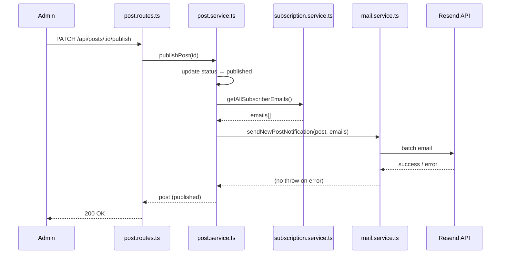
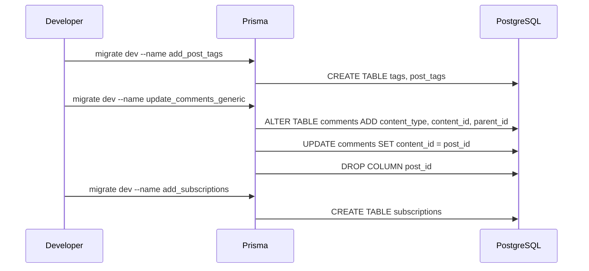

# Design Document

## Stage 1 Blog Improvements + UI Standardization — Personal Everything Website

---

## Overview

Stage 1 dibangun sepenuhnya di atas arsitektur layered yang ada (Router → Middleware → Controller → Service → Prisma). Tidak ada pola arsitektur baru yang diperkenalkan. Perubahan struktural utama adalah:

1. shadcn/ui menggantikan komponen UI hand-rolled
2. Model `Comment` digeneralisasi dari post-scoped menjadi content-type-scoped dengan dukungan balasan
3. Model baru `Tag`, `PostTag`, `Subscription` ditambahkan ke skema Prisma
4. Dua modul service baru: `MailService` dan `SubscriptionService`
5. Komponen bersama `MarkdownRenderer` menggantikan semua penggunaan `dangerouslySetInnerHTML` dan `react-markdown` langsung

### Batasan Desain

- Tidak ada halaman publik baru yang diperkenalkan — semua perubahan berada di blog section yang ada dan dashboard admin.
- Stage ini hanya memperluas section blog yang ada; fondasi yang dibuat (sistem komentar generik, shadcn/ui) akan digunakan kembali di Stage 2 dan 3.

---

## Architecture

### Alur Publish → Notifikasi Email



> Catatan: Jika `RESEND_API_KEY` tidak ada, `MailService.sendNewPostNotification` langsung return tanpa memanggil Resend. Kegagalan pengiriman email dibungkus `try/catch` di `publishPost` sehingga tidak menggagalkan operasi publish.

### Urutan Migrasi Database



---

## Components and Interfaces

### Perubahan Skema Database

**Model baru: Tag**

```prisma
model Tag {
  id    String    @id @default(dbgenerated("gen_random_uuid()")) @db.Uuid
  name  String    @unique @db.VarChar(100)
  slug  String    @unique @db.VarChar(110)
  posts PostTag[]
  @@map("tags")
}
```

**Model baru: PostTag**

```prisma
model PostTag {
  postId String @map("post_id") @db.Uuid
  tagId  String @map("tag_id") @db.Uuid
  post   Post   @relation(fields: [postId], references: [id], onDelete: Cascade)
  tag    Tag    @relation(fields: [tagId], references: [id], onDelete: Cascade)
  @@id([postId, tagId])
  @@map("post_tags")
}
```

**Model baru: Subscription**

```prisma
model Subscription {
  id        String   @id @default(dbgenerated("gen_random_uuid()")) @db.Uuid
  userId    String   @unique @map("user_id") @db.Uuid
  createdAt DateTime @default(now()) @map("created_at") @db.Timestamptz()
  user      User     @relation(fields: [userId], references: [id], onDelete: Cascade)
  @@map("subscriptions")
}
```

**Model yang dimodifikasi: Comment** — Strategi migrasi dua langkah untuk menghindari kehilangan data:

Langkah 1 (additive): tambah kolom baru dengan default, lalu migrasikan data
```sql
ALTER TABLE comments
  ADD COLUMN content_type VARCHAR(10) NOT NULL DEFAULT 'post',
  ADD COLUMN content_id   UUID,
  ADD COLUMN parent_id    UUID REFERENCES comments(id) ON DELETE CASCADE;

UPDATE comments SET content_id = post_id WHERE post_id IS NOT NULL;
ALTER TABLE comments ALTER COLUMN content_id SET NOT NULL;
```

Langkah 2 (cleanup): hapus kolom lama
```sql
ALTER TABLE comments DROP CONSTRAINT comments_post_id_fkey;
ALTER TABLE comments DROP COLUMN post_id;
```

### Endpoint API

Semua endpoint admin berada dalam satu router `routes/admin.routes.ts` yang di-mount di `/api/admin`.

**Tags**

| Method | Path | Auth | Deskripsi |
|--------|------|------|-----------|
| GET | `/api/tags` | Public | Daftar semua tag urut alfabetis |

Respons: `[{ "id": "uuid", "name": "math", "slug": "math" }]`

Body create/update post diperluas dengan `"tags": ["math", "tutorial"]`. Logika upsert tag di `post.service.ts`: normalisasi ke lowercase, slugify, upsert by name, connect via PostTag. Pada `updatePost`: disconnect semua PostTag yang ada, lalu reconnect dengan daftar baru (full replace strategy).

**Komentar Generik**

| Method | Path | Auth | Deskripsi |
|--------|------|------|-----------|
| GET | `/api/comments?contentType=&contentId=` | Public | Daftar komentar level atas + balasan |
| POST | `/api/comments` | JWT | Buat komentar atau balasan |
| DELETE | `/api/comments/:id` | JWT | Hapus komentar sendiri (admin: semua) |
| POST | `/api/posts/:postId/comments` | JWT | Alias backward-compatible |

Respons GET: array komentar level atas masing-masing dengan array `replies` bersarang. Di-fetch via Prisma `include: { replies: { include: { author: true } } }`.

Body POST: `{ "contentType": "post", "contentId": "uuid", "content": "...", "parentId": "uuid-or-null" }`

Penegakan kedalaman: jika `parentId` disediakan, load parent; jika `parent.parentId` tidak null, throw 400 `REPLY_DEPTH_EXCEEDED`.

**Langganan**

| Method | Path | Auth | Deskripsi |
|--------|------|------|-----------|
| POST | `/api/subscriptions` | JWT | Subscribe user saat ini |
| DELETE | `/api/subscriptions` | JWT | Unsubscribe |
| GET | `/api/subscriptions/status` | JWT | Cek status langganan |

- POST → 201 `{ "subscribed": true }` atau 409 `ALREADY_SUBSCRIBED`
- DELETE → 204 atau 404 `NOT_SUBSCRIBED`
- GET `/status` → 200 `{ "subscribed": true | false }`

**Admin Stats, Users, dan Comments**

| Method | Path | Auth | Deskripsi |
|--------|------|------|-----------|
| GET | `/api/admin/stats` | Admin | Ringkasan statistik dashboard |
| GET | `/api/admin/users?page=` | Admin | Daftar pengguna dipaginasi dengan commentCount |
| DELETE | `/api/admin/users/:id` | Admin | Hapus pengguna + cascade comments |
| GET | `/api/admin/comments?page=` | Admin | Semua komentar dipaginasi |

Respons `GET /api/admin/stats`:
```json
{
  "totalPosts": 10,
  "totalComments": 42,
  "totalUsers": 18,
  "recentPosts": [],
  "recentComments": [],
  "recentUsers": []
}
```

Item `recentComments` menyertakan: `id`, `content`, `authorUsername`, `contentType`, `contentId`, `contentTitle`, `createdAt`. `contentTitle` di-resolve via join pada `posts.title` untuk `contentType=post`; tipe konten lain ditambahkan di stage berikutnya.

`GET /api/admin/comments` mendukung query param opsional `?contentType=` untuk filtering. Di Stage 1 hanya `post` yang ada; filter ini forward-compatible dengan Stage 2 dan 3.

### Komponen Frontend

**MarkdownRenderer**

Lokasi: `frontend/src/components/shared/MarkdownRenderer.tsx`

Membungkus `react-markdown` dengan plugin `remarkMath` dan `rehypeKatex`. Menerapkan class string Tailwind prose yang saat ini ada di PostDetailPage. Menerima props `content: string` dan `className` opsional.

Import KaTeX CSS ditambahkan sekali di `frontend/src/main.tsx`: `import 'katex/dist/katex.min.css'`

PostDetailPage beralih dari `post.contentHtml` (server-rendered) ke `post.content` (raw Markdown) karena KaTeX kini dirender di sisi klien. Backend tetap mengirim `contentHtml` untuk backward compatibility.

**TagInput**

Lokasi: `frontend/src/components/shared/TagInput.tsx`

Menggunakan shadcn `Command` + `Popover` (pola Combobox). Saran di-fetch dari `GET /api/tags` via React Query (`staleTime: Infinity`). Emits `onChange(tags: string[])` ke parent form.

**TagChip**

Lokasi: `frontend/src/components/shared/TagChip.tsx`

Menggunakan shadcn `Badge`, display-only. Menampilkan nama tag.

**SubscribeButton**

Lokasi: `frontend/src/components/shared/SubscribeButton.tsx`

Tidak merender apa pun jika pengguna tidak terotentikasi. Menggunakan hook `useSubscription`. Menampilkan loading state selama mutasi. POST saat subscribe, DELETE saat unsubscribe.

**useSubscription hook**

Lokasi: `frontend/src/hooks/useSubscription.ts`

Mengembalikan `{ subscribed, isLoading, subscribe, unsubscribe, isMutating }`. Menggunakan `useQuery` + `useMutation`. Invalidates query saat mutasi berhasil.

**StatCard**

Lokasi: `frontend/src/components/admin/StatCard.tsx`

Komponen kartu statistik yang dapat digunakan kembali di dashboard admin. Props:

```tsx
interface StatCardProps {
  label: string;         // contoh: "Total Posts"
  value: number;
  icon: React.ReactNode; // inline SVG
  href?: string;         // target navigasi opsional saat diklik
}
```

Menggunakan shadcn `Card`. Komponen ini sengaja dibuat generik agar Stage 2 dan 3 dapat menambahkan kartu statistik baru (Projects, Fun, Modules) tanpa mengubah komponen.

**Strategi Migrasi shadcn/ui**

shadcn meng-generate ke `frontend/src/components/ui/`. Komponen yang ada menggunakan CSS variables yang sama sehingga tampilan visual hampir identik.

Konflik penamaan yang perlu diselesaikan sebelum menjalankan `npx shadcn@latest add`: rename `Button.tsx` → `Button.bak.tsx`, `Input.tsx` → `Input.bak.tsx`, `Badge.tsx` → `Badge.bak.tsx`, `Pagination.tsx` → `Pagination.bak.tsx`. Setelah semua call site diperbarui dan tests lulus, hapus file `.bak.tsx`.

Codebase yang ada menggunakan `variant="primary"` pada Button — petakan ke `variant="default"` pada shadcn Button di semua call site.

**Desain Update CommentList dan CommentForm**

CommentList menerima: `contentType`, `contentId`, `comments` (level atas dengan `replies[]`), `currentUserId`, `currentUserRole`, `onDeleteComment`.

CommentForm menerima: `contentType`, `contentId`, `parentId` (opsional), `parentAuthorUsername` (opsional, di-prepend sebagai @mention), `onCommentAdded`.

State toggle reply berada di CommentList: `replyingTo: string | null`. Klik Reply mengatur `replyingTo = comment.id`; klik lagi atau setelah submit me-reset ke null.

### Desain Service

**MailService**

Lokasi: `backend/src/services/mail.service.ts`

Dependensi backend baru: `resend` — install dengan `npm install resend` di `backend/` sebelum menyambungkan service.

Menginisialisasi Resend client dengan env var `RESEND_API_KEY`; mengatur client ke `null` jika key tidak ada. `sendNewPostNotification(post, emails[])` langsung return jika client `null` atau `emails` kosong (no-op). Di-export sebagai singleton: `export const mailService = new MailService()`.

**SubscriptionService**

Lokasi: `backend/src/services/subscription.service.ts`

- `subscribe(userId)`: membuat Subscription; throw 409 `ALREADY_SUBSCRIBED` jika unique constraint terpicu
- `unsubscribe(userId)`: hapus; throw 404 `NOT_SUBSCRIBED` jika tidak ditemukan
- `getStatus(userId)`: mengembalikan `{ subscribed: boolean }`
- `getAllSubscriberEmails()`: mengembalikan semua email subscriber (join dengan tabel users)

Integrasi `publishPost`: setelah status update berhasil, panggil `getAllSubscriberEmails` lalu `mailService.sendNewPostNotification` di dalam `try/catch`. Kegagalan email tidak boleh menggagalkan publish — log error dan lanjutkan.

### MarkdownToolbar Component

Lokasi: `frontend/src/components/admin/MarkdownToolbar.tsx`

Komponen toolbar formatting Markdown yang terpasang di atas textarea `PostEditor`. Diimplementasikan sebagai komponen React murni tanpa dependensi library tambahan.

**Props:**

```tsx
interface MarkdownToolbarProps {
  value: string;
  onChange: (newValue: string) => void;
  textareaRef: RefObject<HTMLTextAreaElement>;
}
```

**Tombol dan ikon toolbar (kiri ke kanan):**

| Tombol | Ikon | Aksi Markdown |
|--------|------|----------------|
| Undo | ↩ | Batalkan aksi toolbar terakhir |
| Redo | ↪ | Ulangi aksi yang dibatalkan |
| Bold | **B** | `**teks**` |
| Italic | *I* | `*teks*` |
| H1 | H₁ | `# ` prefix toggle |
| H2 | H₂ | `## ` prefix toggle |
| H3 | H₃ | `### ` prefix toggle |
| H4 | H₄ | `#### ` prefix toggle |
| Strikethrough | ~~S~~ | `~~teks~~` |
| Unordered list | ☰ | `- ` prefix toggle |
| Ordered list | 1. | `1. ` prefix toggle |
| Task list | ☐ | `- [ ] ` prefix toggle |
| Blockquote | > | `> ` prefix toggle |
| Inline code | `` | backtick wrap |
| Code block | { } | triple backtick block |
| Inline math | $ | `$expr# Design Document

## Stage 1 Blog Improvements + UI Standardization — Personal Everything Website

---

## Overview

Stage 1 dibangun sepenuhnya di atas arsitektur layered yang ada (Router → Middleware → Controller → Service → Prisma). Tidak ada pola arsitektur baru yang diperkenalkan. Perubahan struktural utama adalah:

1. shadcn/ui menggantikan komponen UI hand-rolled
2. Model `Comment` digeneralisasi dari post-scoped menjadi content-type-scoped dengan dukungan balasan
3. Model baru `Tag`, `PostTag`, `Subscription` ditambahkan ke skema Prisma
4. Dua modul service baru: `MailService` dan `SubscriptionService`
5. Komponen bersama `MarkdownRenderer` menggantikan semua penggunaan `dangerouslySetInnerHTML` dan `react-markdown` langsung

### Batasan Desain

- Tidak ada halaman publik baru yang diperkenalkan — semua perubahan berada di blog section yang ada dan dashboard admin.
- Stage ini hanya memperluas section blog yang ada; fondasi yang dibuat (sistem komentar generik, shadcn/ui) akan digunakan kembali di Stage 2 dan 3.

---

## Architecture

### Alur Publish → Notifikasi Email


> Catatan: Jika `RESEND_API_KEY` tidak ada, `MailService.sendNewPostNotification` langsung return tanpa memanggil Resend. Kegagalan pengiriman email dibungkus `try/catch` di `publishPost` sehingga tidak menggagalkan operasi publish.

### Urutan Migrasi Database


---

## Components and Interfaces

### Perubahan Skema Database

**Model baru: Tag**

```prisma
model Tag {
  id    String    @id @default(dbgenerated("gen_random_uuid()")) @db.Uuid
  name  String    @unique @db.VarChar(100)
  slug  String    @unique @db.VarChar(110)
  posts PostTag[]
  @@map("tags")
}
```

**Model baru: PostTag**

```prisma
model PostTag {
  postId String @map("post_id") @db.Uuid
  tagId  String @map("tag_id") @db.Uuid
  post   Post   @relation(fields: [postId], references: [id], onDelete: Cascade)
  tag    Tag    @relation(fields: [tagId], references: [id], onDelete: Cascade)
  @@id([postId, tagId])
  @@map("post_tags")
}
```

**Model baru: Subscription**

```prisma
model Subscription {
  id        String   @id @default(dbgenerated("gen_random_uuid()")) @db.Uuid
  userId    String   @unique @map("user_id") @db.Uuid
  createdAt DateTime @default(now()) @map("created_at") @db.Timestamptz()
  user      User     @relation(fields: [userId], references: [id], onDelete: Cascade)
  @@map("subscriptions")
}
```

**Model yang dimodifikasi: Comment** — Strategi migrasi dua langkah untuk menghindari kehilangan data:

Langkah 1 (additive): tambah kolom baru dengan default, lalu migrasikan data
```sql
ALTER TABLE comments
  ADD COLUMN content_type VARCHAR(10) NOT NULL DEFAULT 'post',
  ADD COLUMN content_id   UUID,
  ADD COLUMN parent_id    UUID REFERENCES comments(id) ON DELETE CASCADE;

UPDATE comments SET content_id = post_id WHERE post_id IS NOT NULL;
ALTER TABLE comments ALTER COLUMN content_id SET NOT NULL;
```

Langkah 2 (cleanup): hapus kolom lama
```sql
ALTER TABLE comments DROP CONSTRAINT comments_post_id_fkey;
ALTER TABLE comments DROP COLUMN post_id;
```

### Endpoint API

Semua endpoint admin berada dalam satu router `routes/admin.routes.ts` yang di-mount di `/api/admin`.

**Tags**

| Method | Path | Auth | Deskripsi |
|--------|------|------|-----------|
| GET | `/api/tags` | Public | Daftar semua tag urut alfabetis |

Respons: `[{ "id": "uuid", "name": "math", "slug": "math" }]`

Body create/update post diperluas dengan `"tags": ["math", "tutorial"]`. Logika upsert tag di `post.service.ts`: normalisasi ke lowercase, slugify, upsert by name, connect via PostTag. Pada `updatePost`: disconnect semua PostTag yang ada, lalu reconnect dengan daftar baru (full replace strategy).

**Komentar Generik**

| Method | Path | Auth | Deskripsi |
|--------|------|------|-----------|
| GET | `/api/comments?contentType=&contentId=` | Public | Daftar komentar level atas + balasan |
| POST | `/api/comments` | JWT | Buat komentar atau balasan |
| DELETE | `/api/comments/:id` | JWT | Hapus komentar sendiri (admin: semua) |
| POST | `/api/posts/:postId/comments` | JWT | Alias backward-compatible |

Respons GET: array komentar level atas masing-masing dengan array `replies` bersarang. Di-fetch via Prisma `include: { replies: { include: { author: true } } }`.

Body POST: `{ "contentType": "post", "contentId": "uuid", "content": "...", "parentId": "uuid-or-null" }`

Penegakan kedalaman: jika `parentId` disediakan, load parent; jika `parent.parentId` tidak null, throw 400 `REPLY_DEPTH_EXCEEDED`.

**Langganan**

| Method | Path | Auth | Deskripsi |
|--------|------|------|-----------|
| POST | `/api/subscriptions` | JWT | Subscribe user saat ini |
| DELETE | `/api/subscriptions` | JWT | Unsubscribe |
| GET | `/api/subscriptions/status` | JWT | Cek status langganan |

- POST → 201 `{ "subscribed": true }` atau 409 `ALREADY_SUBSCRIBED`
- DELETE → 204 atau 404 `NOT_SUBSCRIBED`
- GET `/status` → 200 `{ "subscribed": true | false }`

**Admin Stats, Users, dan Comments**

| Method | Path | Auth | Deskripsi |
|--------|------|------|-----------|
| GET | `/api/admin/stats` | Admin | Ringkasan statistik dashboard |
| GET | `/api/admin/users?page=` | Admin | Daftar pengguna dipaginasi dengan commentCount |
| DELETE | `/api/admin/users/:id` | Admin | Hapus pengguna + cascade comments |
| GET | `/api/admin/comments?page=` | Admin | Semua komentar dipaginasi |

Respons `GET /api/admin/stats`:
```json
{
  "totalPosts": 10,
  "totalComments": 42,
  "totalUsers": 18,
  "recentPosts": [],
  "recentComments": [],
  "recentUsers": []
}
```

Item `recentComments` menyertakan: `id`, `content`, `authorUsername`, `contentType`, `contentId`, `contentTitle`, `createdAt`. `contentTitle` di-resolve via join pada `posts.title` untuk `contentType=post`; tipe konten lain ditambahkan di stage berikutnya.

`GET /api/admin/comments` mendukung query param opsional `?contentType=` untuk filtering. Di Stage 1 hanya `post` yang ada; filter ini forward-compatible dengan Stage 2 dan 3.

### Komponen Frontend

**MarkdownRenderer**

Lokasi: `frontend/src/components/shared/MarkdownRenderer.tsx`

Membungkus `react-markdown` dengan plugin `remarkMath` dan `rehypeKatex`. Menerapkan class string Tailwind prose yang saat ini ada di PostDetailPage. Menerima props `content: string` dan `className` opsional.

Import KaTeX CSS ditambahkan sekali di `frontend/src/main.tsx`: `import 'katex/dist/katex.min.css'`

PostDetailPage beralih dari `post.contentHtml` (server-rendered) ke `post.content` (raw Markdown) karena KaTeX kini dirender di sisi klien. Backend tetap mengirim `contentHtml` untuk backward compatibility.

**TagInput**

Lokasi: `frontend/src/components/shared/TagInput.tsx`

Menggunakan shadcn `Command` + `Popover` (pola Combobox). Saran di-fetch dari `GET /api/tags` via React Query (`staleTime: Infinity`). Emits `onChange(tags: string[])` ke parent form.

**TagChip**

Lokasi: `frontend/src/components/shared/TagChip.tsx`

Menggunakan shadcn `Badge`, display-only. Menampilkan nama tag.

**SubscribeButton**

Lokasi: `frontend/src/components/shared/SubscribeButton.tsx`

Tidak merender apa pun jika pengguna tidak terotentikasi. Menggunakan hook `useSubscription`. Menampilkan loading state selama mutasi. POST saat subscribe, DELETE saat unsubscribe.

**useSubscription hook**

Lokasi: `frontend/src/hooks/useSubscription.ts`

Mengembalikan `{ subscribed, isLoading, subscribe, unsubscribe, isMutating }`. Menggunakan `useQuery` + `useMutation`. Invalidates query saat mutasi berhasil.

**StatCard**

Lokasi: `frontend/src/components/admin/StatCard.tsx`

Komponen kartu statistik yang dapat digunakan kembali di dashboard admin. Props:

```tsx
interface StatCardProps {
  label: string;         // contoh: "Total Posts"
  value: number;
  icon: React.ReactNode; // inline SVG
  href?: string;         // target navigasi opsional saat diklik
}
```

Menggunakan shadcn `Card`. Komponen ini sengaja dibuat generik agar Stage 2 dan 3 dapat menambahkan kartu statistik baru (Projects, Fun, Modules) tanpa mengubah komponen.

**Strategi Migrasi shadcn/ui**

shadcn meng-generate ke `frontend/src/components/ui/`. Komponen yang ada menggunakan CSS variables yang sama sehingga tampilan visual hampir identik.

Konflik penamaan yang perlu diselesaikan sebelum menjalankan `npx shadcn@latest add`: rename `Button.tsx` → `Button.bak.tsx`, `Input.tsx` → `Input.bak.tsx`, `Badge.tsx` → `Badge.bak.tsx`, `Pagination.tsx` → `Pagination.bak.tsx`. Setelah semua call site diperbarui dan tests lulus, hapus file `.bak.tsx`.

Codebase yang ada menggunakan `variant="primary"` pada Button — petakan ke `variant="default"` pada shadcn Button di semua call site.

**Desain Update CommentList dan CommentForm**

CommentList menerima: `contentType`, `contentId`, `comments` (level atas dengan `replies[]`), `currentUserId`, `currentUserRole`, `onDeleteComment`.

CommentForm menerima: `contentType`, `contentId`, `parentId` (opsional), `parentAuthorUsername` (opsional, di-prepend sebagai @mention), `onCommentAdded`.

State toggle reply berada di CommentList: `replyingTo: string | null`. Klik Reply mengatur `replyingTo = comment.id`; klik lagi atau setelah submit me-reset ke null.

### Desain Service

**MailService**

Lokasi: `backend/src/services/mail.service.ts`

Dependensi backend baru: `resend` — install dengan `npm install resend` di `backend/` sebelum menyambungkan service.

Menginisialisasi Resend client dengan env var `RESEND_API_KEY`; mengatur client ke `null` jika key tidak ada. `sendNewPostNotification(post, emails[])` langsung return jika client `null` atau `emails` kosong (no-op). Di-export sebagai singleton: `export const mailService = new MailService()`.

**SubscriptionService**

Lokasi: `backend/src/services/subscription.service.ts`

- `subscribe(userId)`: membuat Subscription; throw 409 `ALREADY_SUBSCRIBED` jika unique constraint terpicu
- `unsubscribe(userId)`: hapus; throw 404 `NOT_SUBSCRIBED` jika tidak ditemukan
- `getStatus(userId)`: mengembalikan `{ subscribed: boolean }`
- `getAllSubscriberEmails()`: mengembalikan semua email subscriber (join dengan tabel users)

Integrasi `publishPost`: setelah status update berhasil, panggil `getAllSubscriberEmails` lalu `mailService.sendNewPostNotification` di dalam `try/catch`. Kegagalan email tidak boleh menggagalkan publish — log error dan lanjutkan.
 |
| Display math | $ | `$\nexpr\n$` |
| Tabel | ⊞ | template tabel 2×2 |
| Link | 🔗 | `[teks](url)` |
| Image URL | 🖼 | `` |

**Fungsi helper murni** (dapat diuji independen dari UI):

- `wrapSelection(value, start, end, pre, post, placeholder)` — membungkus seleksi atau menyisipkan placeholder; digunakan oleh Bold, Italic, Strikethrough, Inline code, Inline math, Display math
- `prefixLines(value, start, end, prefix)` — menambahkan atau menghapus prefix pada setiap baris yang terseleksi (toggle); digunakan oleh Unordered list, Ordered list, Task list, Blockquote
- `setHeading(value, start, level)` — mengganti atau menghapus prefix heading pada baris saat ini; jika level sama → hapus; jika level berbeda → ganti
- `insertTemplate(value, start, template, cursorOffset)` — menyisipkan string template di posisi kursor dan menempatkan kursor di `cursorOffset`; digunakan oleh Tabel, Link, Image, Code block

**Undo/Redo:**

Stack history disimpan di `PostEditor` sebagai `historyStack: string[]` dan `historyIndex: number`. Sebelum setiap aksi toolbar, snapshot konten saat ini di-push ke stack (jika berbeda dari snapshot terakhir). Undo/Redo navigasi maju-mundur di stack. Stack dibatasi 50 entri untuk mencegah penggunaan memori berlebihan.

**Penempatan kursor setelah aksi:**

Setelah `onChange` dipanggil, React melakukan re-render terlebih dahulu sebelum DOM diperbarui. Pemulihan seleksi dilakukan via `useEffect` yang berjalan setelah render, menggunakan `textareaRef.current.setSelectionRange(newStart, newEnd)`.


---

## Data Models

### Model Final Tag

```prisma
model Tag {
  id    String    @id @default(dbgenerated("gen_random_uuid()")) @db.Uuid
  name  String    @unique @db.VarChar(100)
  slug  String    @unique @db.VarChar(110)
  posts PostTag[]
  @@map("tags")
}
```

### Model Final PostTag

```prisma
model PostTag {
  postId String @map("post_id") @db.Uuid
  tagId  String @map("tag_id") @db.Uuid
  post   Post   @relation(fields: [postId], references: [id], onDelete: Cascade)
  tag    Tag    @relation(fields: [tagId], references: [id], onDelete: Cascade)
  @@id([postId, tagId])
  @@map("post_tags")
}
```

### Model Final Subscription

```prisma
model Subscription {
  id        String   @id @default(dbgenerated("gen_random_uuid()")) @db.Uuid
  userId    String   @unique @map("user_id") @db.Uuid
  createdAt DateTime @default(now()) @map("created_at") @db.Timestamptz()
  user      User     @relation(fields: [userId], references: [id], onDelete: Cascade)
  @@map("subscriptions")
}
```

### Model Final Comment

```prisma
model Comment {
  id          String    @id @default(dbgenerated("gen_random_uuid()")) @db.Uuid
  contentType String    @map("content_type") @db.VarChar(10)
  contentId   String    @map("content_id") @db.Uuid
  authorId    String    @map("author_id") @db.Uuid
  content     String    @db.Text
  parentId    String?   @map("parent_id") @db.Uuid
  createdAt   DateTime  @default(now()) @map("created_at") @db.Timestamptz()
  author      User      @relation(fields: [authorId], references: [id], onDelete: Cascade)
  parent      Comment?  @relation("CommentReplies", fields: [parentId], references: [id], onDelete: Cascade)
  replies     Comment[] @relation("CommentReplies")
  @@index([contentType, contentId, createdAt(sort: Asc)], name: "idx_comments_content")
  @@index([parentId], name: "idx_comments_parent_id")
  @@map("comments")
}
```

Nilai valid `contentType`: `post`, `project`, `fun`, `module`.

### Konfigurasi yang Relevan

| Variabel | Deskripsi |
|---|---|
| `RESEND_API_KEY` | API key Resend SDK; tidak ada = MailService no-op |
| `RESEND_FROM_EMAIL` | Alamat pengirim email notifikasi |

### Urutan Eksekusi Migrasi

1. `add_post_tags` — tambah Tag + PostTag (tidak ada migrasi data)
2. `update_comments_generic` — dua langkah: tambah `content_type`/`content_id`/`parent_id` + copy data `post_id`; kemudian drop `post_id`
3. `add_subscriptions` — tambah Subscription (tidak ada migrasi data)

Subscription dan migrasi komentar generik bersifat independen — urutan antara 2 dan 3 tidak masalah secara teknis. Urutan di atas mengikuti urutan eksekusi task (Task 6 sebelum Task 10).

Setiap migrasi: `npx prisma migrate dev --name <name>` diikuti `npx prisma generate`.

---

## Correctness Properties

*A property is a characteristic or behavior that should hold true across all valid executions of a system — essentially, a formal statement about what the system should do. Properties serve as the bridge between human-readable specifications and machine-verifiable correctness guarantees.*

### Property 1: Tag Upsert Idempotency

*For any* tag name `n`, memanggil upsert berapa kali pun menghasilkan tepat satu record Tag dengan `name = n.toLowerCase()`. Tidak ada duplikat, tidak ada error pada pemanggilan berulang.

**Validates: Requirements 2.1, 2.7**

### Property 2: Comment Depth Enforcement

*For any* comment `C` di mana `C.parentId` tidak null, `C.parent.parentId` harus selalu null. Setiap upaya membuat reply kedalaman 2 mengembalikan 400 `REPLY_DEPTH_EXCEEDED`.

**Validates: Requirements 5.5**

### Property 3: Generic Comment Isolation

*For any* dua pasangan `(contentType, contentId)` yang berbeda, `GET /api/comments` untuk satu pasangan tidak pernah mengembalikan komentar milik pasangan lainnya.

**Validates: Requirements 5.3**

### Property 4: Subscription Uniqueness

*For any* user `U`, paling banyak satu record Subscription yang ada dengan `userId = U.id`. Setiap panggilan subscribe duplikat mengembalikan 409 dan tidak membuat record kedua.

**Validates: Requirements 6.1**

### Property 5: Publish Triggers Notification Once

*For any* post `P` yang bertransisi dari draft ke published tepat satu kali, `mailService.sendNewPostNotification` dipanggil tepat satu kali dengan data post yang benar dan semua email subscriber yang aktif.

**Validates: Requirements 6.4**

---

## Error Handling

### Konflik Tag Upsert

Tag di-upsert by `name` (setelah normalisasi ke lowercase) sehingga tidak ada konflik duplikat pada `createPost`/`updatePost`. Jika dua request bersamaan mencoba membuat tag yang sama, database unique constraint menanganinya — Prisma `upsert` dengan `where: { name }` aman untuk digunakan.

### Comment Depth Exceeded

Pada `addComment`, jika `parentId` disediakan: load parent dari DB; jika `parent.parentId !== null`, lempar error 400 dengan kode `REPLY_DEPTH_EXCEEDED` sebelum mencoba insert. Controller memetakan error ini ke respons HTTP 400.

### Subscription Already Exists / Not Found

`subscribe(userId)` menggunakan `prisma.subscription.create` — jika unique constraint pada `userId` terpicu (Prisma error P2002), service melempar 409 `ALREADY_SUBSCRIBED`. `unsubscribe(userId)` menggunakan `prisma.subscription.delete` — jika record tidak ditemukan (Prisma error P2025), service melempar 404 `NOT_SUBSCRIBED`.

### RESEND_API_KEY Tidak Ada

`MailService` memeriksa keberadaan `process.env.RESEND_API_KEY` saat inisialisasi. Jika tidak ada atau kosong, `this.client` diatur ke `null` dan log warning ditampilkan. Semua method yang memanggil Resend memeriksa `this.client === null` terlebih dahulu dan langsung return jika null — tidak ada exception yang dilempar.

### Kegagalan Email Saat Publish

Di `post.service.ts`, blok pengiriman email dibungkus:
```typescript
try {
  const emails = await subscriptionService.getAllSubscriberEmails();
  await mailService.sendNewPostNotification(post, emails);
} catch (err) {
  console.error('Email notification failed:', err);
  // publish tetap berhasil
}
```

### Migrasi Comment Dua Langkah

Migrasi `update_comments_generic` harus dua langkah untuk menghindari kehilangan data: (1) tambah kolom baru, copy data dari `post_id` ke `content_id`, kemudian (2) drop kolom `post_id`. Jika langkah 1 berhasil tetapi langkah 2 gagal, data tidak hilang dan dapat di-retry.

---

## Testing Strategy

### Pendekatan Pengujian Ganda

Stage 1 menggunakan kombinasi unit tests, integration tests, component tests, dan property-based tests untuk cakupan komprehensif.

### Unit Tests

- Tag upsert idempotency: panggil upsert berkali-kali dengan nama yang sama → hasilnya satu record
- Tag normalisasi lowercase: `"MATH"` → tag dengan `name: "math"`
- `MailService.sendNewPostNotification` dengan mocked Resend client — dipanggil dengan email yang benar; no-op saat key tidak ada (Property 5)
- `SubscriptionService.subscribe` duplicate → 409; `unsubscribe` not found → 404

### Integration Tests

- `POST /api/posts` dengan tags → `GET /api/posts/:slug` mengembalikan tags
- `PUT /api/posts/:id` → tags lama dihapus, tags baru terset
- `GET /api/tags` mengembalikan daftar yang benar
- `POST /api/comments` dengan `contentType: 'post'` → 201; GET mengembalikannya bersarang
- POST reply ke komentar level atas → 201; GET mengembalikan reply bersarang di bawah parent
- POST reply ke reply → 400 `REPLY_DEPTH_EXCEEDED`
- DELETE komentar parent → replies terhapus cascade
- Admin JWT POST komentar → 201; admin JWT DELETE komentar siapapun → 204
- `POST /api/subscriptions` → 201; panggil kedua → 409
- `DELETE /api/subscriptions` → 204; panggil kedua → 404
- `GET /api/subscriptions/status` mengembalikan boolean yang benar sebelum dan sesudah subscribe
- `GET /api/admin/stats` mengembalikan shape yang benar
- `GET /api/admin/users` mengembalikan daftar dipaginasi dengan `commentCount`
- `DELETE /api/admin/users/:id` menghapus user dan cascade comments
- `GET /api/admin/comments` mengembalikan semua komentar di semua content type

### Component Tests (Frontend)

- `MarkdownRenderer`: `$x^2$` → elemen `<span class="katex">` hadir; `$$\int_0^1 f\,dx$$` → elemen display math hadir; heading/code block/link masih render; `` merender tag ``
- `TagChip`: merender nama dengan benar
- `TagInput`: tambah tag via Enter, hapus tag via ×, dropdown autocomplete muncul dengan data mock
- `SubscribeButton`: menampilkan "Subscribe" saat belum berlangganan, "Subscribed" saat berlangganan, toggle saat diklik
- `StatCard`: merender label, value, dan icon dari data mock
- CommentList: komentar level atas merender dengan tombol "Reply"; reply merender tanpa tombol "Reply"
- CommentList: klik "Reply" membuka form inline pre-filled dengan `@username`
- CommentList: reply bersarang tampil diindentasi di bawah parent

### Property-Based Tests (fast-check, min 100 iterasi)

- **Property 1**: Tag upsert idempotency — untuk sembarang nama tag, hasil selalu satu record dengan `name = n.toLowerCase()` (**Validates: Requirements 2.1, 2.7**)
- **Property 2**: Comment depth enforcement — untuk sembarang komentar dengan `parentId`, `parent.parentId` selalu null (**Validates: Requirements 5.5**)
- **Property 3**: Generic comment isolation — untuk sembarang dua pasangan `(contentType, contentId)` yang berbeda, query untuk satu pasangan tidak pernah mengembalikan komentar dari pasangan lain (**Validates: Requirements 5.3**)
- **Property 4**: Subscription uniqueness — untuk sembarang user, paling banyak satu Subscription record per userId (**Validates: Requirements 6.1**)

Setiap property test menggunakan tag format: `Feature: stage-1-blog-improvements, Property {N}: {deskripsi singkat}`.
