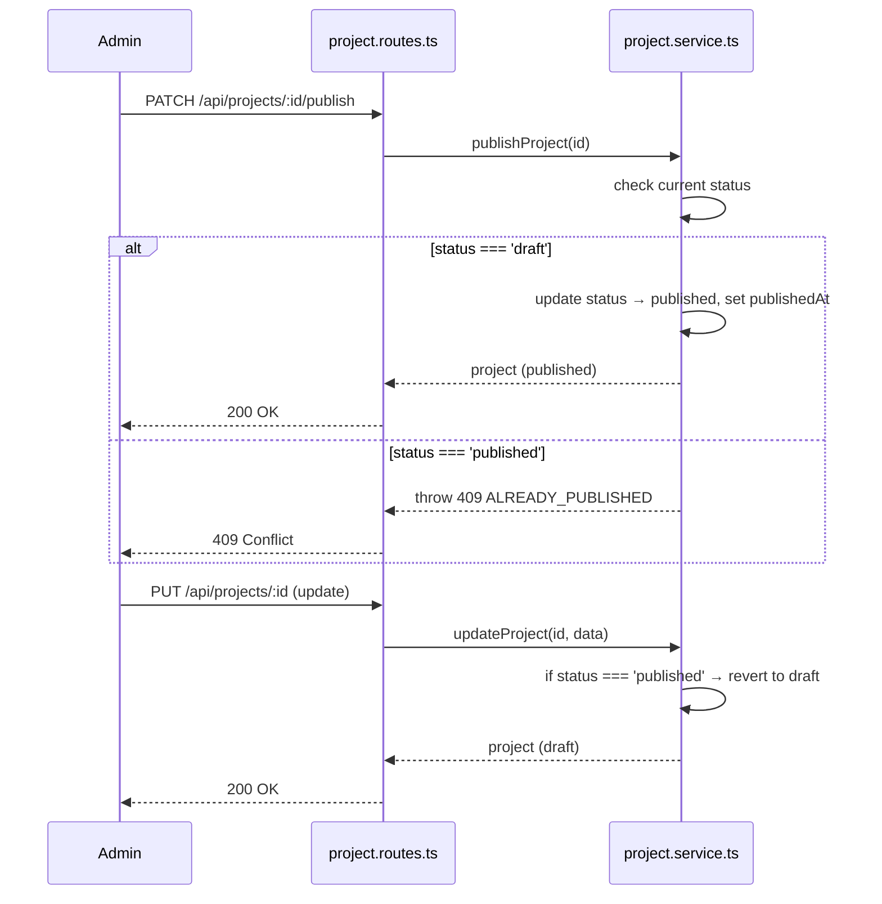
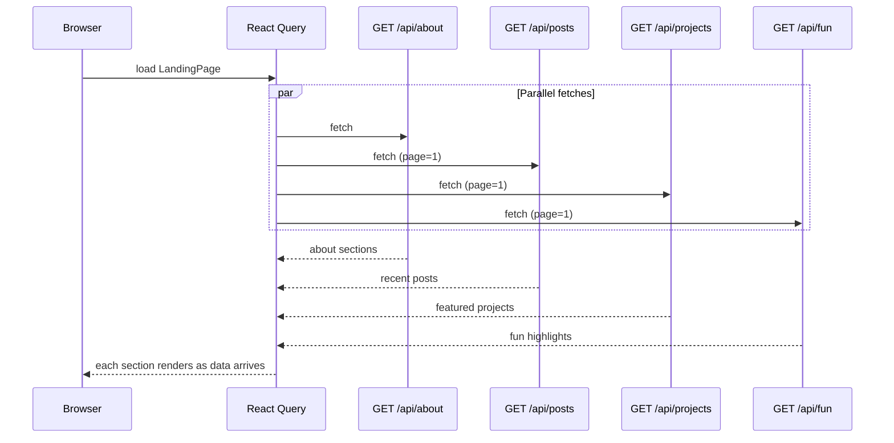

# Design Document

## Stage 2 New Content Sections + Landing Page — Personal Everything Website

---

## Overview

Stage 2 menambahkan empat seksi publik baru (About, Projects, Fun, Landing Page) menggunakan arsitektur layered yang sama yang sudah ada. Setiap seksi baru (About, Projects, Fun) mengikuti pola yang sama: Prisma model → service → controller → route → frontend API module → hook → components → pages.

Model Tag dari Stage 1 digunakan bersama oleh Posts, Projects, dan FunPosts via join table terpisah (PostTag, ProjectTag, FunTag) — namespace tag terpadu. MarkdownRenderer dan sistem komentar generik dari Stage 1 digunakan kembali tanpa modifikasi.

### Batasan Desain

- Tidak ada library baru yang diperkenalkan untuk frontend kecuali `@dnd-kit/core` dan `@dnd-kit/sortable` untuk drag-to-reorder di halaman admin About.
- Generasi slug diekstrak ke `backend/src/lib/slugUtils.ts` agar dapat dibagi antara `post.service.ts`, `project.service.ts`, dan `fun.service.ts`.
- Semua Markdown content dirender di sisi server oleh backend (via `marked`) sebelum dikirim sebagai API response.

---

## Architecture

### Alur Publish Project/Fun



> Alur yang sama berlaku untuk FunPost (`fun.service.ts`) dan identik dengan `post.service.ts` dari Stage 1.

### Landing Page — Pengambilan Data Paralel



> Setiap seksi dikelola secara independen oleh React Query — kegagalan satu fetch tidak mempengaruhi seksi lainnya.

---

## Components and Interfaces

### Perubahan Skema Database

**Model baru: AboutSection**

```prisma
model AboutSection {
  id          String    @id @default(dbgenerated("gen_random_uuid()")) @db.Uuid
  type        String    @db.VarChar(20)
  title       String    @db.VarChar(200)
  subtitle    String?   @db.VarChar(200)
  description String?   @db.Text
  startDate   DateTime? @map("start_date") @db.Date
  endDate     DateTime? @map("end_date") @db.Date
  order       Int       @default(0)
  metadata    Json?
  createdAt   DateTime  @default(now()) @map("created_at") @db.Timestamptz()
  updatedAt   DateTime  @default(now()) @updatedAt @map("updated_at") @db.Timestamptz()
  @@index([type, order])
  @@map("about_sections")
}
```

Nilai valid `type`: `education`, `experience`, `skill`, `contact`.

Contoh penggunaan `metadata`:
- `contact`: `{ "url": "https://github.com/...", "icon": "github" }`
- `skill`: `{ "level": "advanced" }`

**Model baru: Project dan ProjectTag**

```prisma
model Project {
  id            String       @id @default(dbgenerated("gen_random_uuid()")) @db.Uuid
  title         String       @db.VarChar(200)
  slug          String       @unique @db.VarChar(220)
  description   String       @db.Text
  status        String       @default("draft") @db.VarChar(10)
  repoUrl       String?      @map("repo_url") @db.VarChar(500)
  demoUrl       String?      @map("demo_url") @db.VarChar(500)
  coverImageUrl String?      @map("cover_image_url") @db.VarChar(500)
  order         Int          @default(0)
  publishedAt   DateTime?    @map("published_at") @db.Timestamptz()
  createdAt     DateTime     @default(now()) @map("created_at") @db.Timestamptz()
  updatedAt     DateTime     @default(now()) @updatedAt @map("updated_at") @db.Timestamptz()
  techTags      ProjectTag[]
  @@index([status, order])
  @@index([slug])
  @@map("projects")
}

model ProjectTag {
  projectId String  @map("project_id") @db.Uuid
  tagId     String  @map("tag_id") @db.Uuid
  project   Project @relation(fields: [projectId], references: [id], onDelete: Cascade)
  tag       Tag     @relation(fields: [tagId], references: [id], onDelete: Cascade)
  @@id([projectId, tagId])
  @@map("project_tags")
}
```

> Model `Tag` perlu menambahkan field back-relation untuk `ProjectTag` dan `FunTag` dalam migrasi `add_projects`.

**Model baru: FunPost dan FunTag**

```prisma
model FunPost {
  id          String    @id @default(dbgenerated("gen_random_uuid()")) @db.Uuid
  title       String    @db.VarChar(200)
  slug        String    @unique @db.VarChar(220)
  excerpt     String?   @db.VarChar(500)
  content     String    @db.Text
  status      String    @default("draft") @db.VarChar(10)
  type        String    @db.VarChar(20)
  mediaUrl    String?   @map("media_url") @db.VarChar(500)
  publishedAt DateTime? @map("published_at") @db.Timestamptz()
  createdAt   DateTime  @default(now()) @map("created_at") @db.Timestamptz()
  updatedAt   DateTime  @default(now()) @updatedAt @map("updated_at") @db.Timestamptz()
  tags        FunTag[]
  @@index([status, publishedAt(sort: Desc)])
  @@index([slug])
  @@map("fun_posts")
}

model FunTag {
  funPostId String  @map("fun_post_id") @db.Uuid
  tagId     String  @map("tag_id") @db.Uuid
  funPost   FunPost @relation(fields: [funPostId], references: [id], onDelete: Cascade)
  tag       Tag     @relation(fields: [tagId], references: [id], onDelete: Cascade)
  @@id([funPostId, tagId])
  @@map("fun_tags")
}
```

Nilai valid `type`: `text`, `review`, `image`, `drawing`, `music`, `interactive`.

### Endpoint API

**About**

| Method | Path | Auth | Deskripsi |
|--------|------|------|-----------|
| GET | `/api/about` | Public | Semua seksi diurutkan berdasarkan type lalu order |
| POST | `/api/about` | Admin | Buat seksi baru |
| PUT | `/api/about/:id` | Admin | Update seksi |
| DELETE | `/api/about/:id` | Admin | Hapus seksi |
| PATCH | `/api/about/reorder` | Admin | Batch update field order dalam satu transaksi Prisma |

Body `PATCH /api/about/reorder`: `[{ "id": "uuid", "order": 0 }, { "id": "uuid", "order": 1 }]`

Dijalankan sebagai transaksi Prisma: `prisma.$transaction(items.map(i => prisma.aboutSection.update({ where: { id: i.id }, data: { order: i.order } })))`.

**Projects**

| Method | Path | Auth | Deskripsi |
|--------|------|------|-----------|
| GET | `/api/projects` | Public | Daftar project published, dipaginasi |
| GET | `/api/projects/admin` | Admin | Semua project (draft + published) |
| GET | `/api/projects/:slug` | Public | Satu project published |
| POST | `/api/projects` | Admin | Buat project |
| PUT | `/api/projects/:id` | Admin | Update project |
| PATCH | `/api/projects/:id/publish` | Admin | Publish project |
| PATCH | `/api/projects/:id/unpublish` | Admin | Unpublish project |
| DELETE | `/api/projects/:id` | Admin | Hapus project |

Respons project menyertakan: `id`, `title`, `slug`, `description`, `contentHtml` (render `marked` di server), `status`, `repoUrl`, `demoUrl`, `coverImageUrl`, `order`, `techTags[]`, `publishedAt`, `updatedAt`.

State machine identik dengan Post: update pada published → revert ke draft; duplicate publish/unpublish → 409.

**Fun**

| Method | Path | Auth | Deskripsi |
|--------|------|------|-----------|
| GET | `/api/fun` | Public | Daftar published, dipaginasi, filter `?type=` `?tag=` |
| GET | `/api/fun/:slug` | Public | Satu fun post published |
| POST | `/api/fun` | Admin | Buat fun post |
| PUT | `/api/fun/:id` | Admin | Update fun post |
| PATCH | `/api/fun/:id/publish` | Admin | Publish fun post |
| PATCH | `/api/fun/:id/unpublish` | Admin | Unpublish fun post |
| DELETE | `/api/fun/:id` | Admin | Hapus fun post |

Query params `GET /api/fun`: `type` (opsional), `tag` (slug tag, opsional), `page` (default 1). Kedua filter adalah kondisi AND.

`excerpt`: jika tidak disediakan saat create, di-generate otomatis sebagai `content.slice(0, 500)`.

**Pembaruan Admin Stats**

`GET /api/admin/stats` diperluas dengan: `"totalProjects": number, "totalFunPosts": number`.

### Komponen dan Arsitektur Frontend

**SlugUtils**

Ekstrak `generateUniqueSlug` dari `post.service.ts` ke `backend/src/lib/slugUtils.ts` dengan signature yang menerima Prisma query callbacks. Ketiga service (post, project, fun) mengimpor dari utilitas bersama ini.

**Struktur Rute**

Rute publik baru: `/about`, `/projects`, `/projects/:slug`, `/fun`, `/fun/:slug`, `/` (LandingPage), `/blog` (renamed dari `/`).

Rute admin baru (semua protected): `/admin/about`, `/admin/projects`, `/admin/projects/new`, `/admin/projects/:id/edit`, `/admin/fun`, `/admin/fun/new`, `/admin/fun/:id/edit`.

**Komponen Halaman About**

```
AboutPage
├── TimelineSection (education | experience) — sorted by startDate DESC
│   └── TimelineCard (shadcn Card) × N
├── SkillsGrid (skill) — wrapping flex grid
│   └── TagChip (shadcn Badge) × N
└── ContactList (contact) — daftar link berikon
    └── ContactItem (inline SVG icon + link dari metadata.url) × N
```

> Ikon untuk ContactList menggunakan inline SVG saja — tidak menambahkan library ikon berat.

**ProjectEditorPage dan FunEditorPage**

Keduanya mengikuti pola yang sama dengan `CreatePostPage`/`EditPostPage`. URL param `:id` hadir → fetch + prefill (mode edit); tidak ada → mode create. Satu komponen menangani keduanya. React Hook Form + Zod untuk validasi. MarkdownRenderer untuk live preview.

**LandingPage — Pengambilan Data**

Semua lima seksi di-fetch secara paralel via React Query. Setiap seksi dikelola loading/error secara independen — satu seksi gagal tidak mempengaruhi yang lain.

Perilaku seksi kosong: `if (!data || data.length === 0) return null` — seksi disembunyikan seluruhnya, bukan menampilkan kotak kosong.

Seksi: Hero (statis), About teaser (`GET /api/about`, 3 pertama bertipe experience/skill), Recent posts (`GET /api/posts`, 3 pertama), Featured projects (`GET /api/projects`, 3 pertama), Fun highlights (`GET /api/fun`, 3 pertama), Learning CTA (statis).

**Navbar**

Urutan tautan: Brand (`/`) → Blog (`/blog`) → About (`/about`) → Projects (`/projects`) → Fun (`/fun`) → Learning (disabled, Badge "Soon").

Mobile: collapse tautan di balik hamburger toggle menggunakan `useState(isOpen)` — tidak memerlukan library tambahan.

---

## Data Models

### Model Final AboutSection

```prisma
model AboutSection {
  id          String    @id @default(dbgenerated("gen_random_uuid()")) @db.Uuid
  type        String    @db.VarChar(20)
  title       String    @db.VarChar(200)
  subtitle    String?   @db.VarChar(200)
  description String?   @db.Text
  startDate   DateTime? @map("start_date") @db.Date
  endDate     DateTime? @map("end_date") @db.Date
  order       Int       @default(0)
  metadata    Json?
  createdAt   DateTime  @default(now()) @map("created_at") @db.Timestamptz()
  updatedAt   DateTime  @default(now()) @updatedAt @map("updated_at") @db.Timestamptz()
  @@index([type, order])
  @@map("about_sections")
}
```

### Model Final Project

```prisma
model Project {
  id            String       @id @default(dbgenerated("gen_random_uuid()")) @db.Uuid
  title         String       @db.VarChar(200)
  slug          String       @unique @db.VarChar(220)
  description   String       @db.Text
  status        String       @default("draft") @db.VarChar(10)
  repoUrl       String?      @map("repo_url") @db.VarChar(500)
  demoUrl       String?      @map("demo_url") @db.VarChar(500)
  coverImageUrl String?      @map("cover_image_url") @db.VarChar(500)
  order         Int          @default(0)
  publishedAt   DateTime?    @map("published_at") @db.Timestamptz()
  createdAt     DateTime     @default(now()) @map("created_at") @db.Timestamptz()
  updatedAt     DateTime     @default(now()) @updatedAt @map("updated_at") @db.Timestamptz()
  techTags      ProjectTag[]
  @@index([status, order])
  @@index([slug])
  @@map("projects")
}
```

### Model Final ProjectTag

```prisma
model ProjectTag {
  projectId String  @map("project_id") @db.Uuid
  tagId     String  @map("tag_id") @db.Uuid
  project   Project @relation(fields: [projectId], references: [id], onDelete: Cascade)
  tag       Tag     @relation(fields: [tagId], references: [id], onDelete: Cascade)
  @@id([projectId, tagId])
  @@map("project_tags")
}
```

### Model Final FunPost

```prisma
model FunPost {
  id          String    @id @default(dbgenerated("gen_random_uuid()")) @db.Uuid
  title       String    @db.VarChar(200)
  slug        String    @unique @db.VarChar(220)
  excerpt     String?   @db.VarChar(500)
  content     String    @db.Text
  status      String    @default("draft") @db.VarChar(10)
  type        String    @db.VarChar(20)
  mediaUrl    String?   @map("media_url") @db.VarChar(500)
  publishedAt DateTime? @map("published_at") @db.Timestamptz()
  createdAt   DateTime  @default(now()) @map("created_at") @db.Timestamptz()
  updatedAt   DateTime  @default(now()) @updatedAt @map("updated_at") @db.Timestamptz()
  tags        FunTag[]
  @@index([status, publishedAt(sort: Desc)])
  @@index([slug])
  @@map("fun_posts")
}
```

### Model Final FunTag

```prisma
model FunTag {
  funPostId String  @map("fun_post_id") @db.Uuid
  tagId     String  @map("tag_id") @db.Uuid
  funPost   FunPost @relation(fields: [funPostId], references: [id], onDelete: Cascade)
  tag       Tag     @relation(fields: [tagId], references: [id], onDelete: Cascade)
  @@id([funPostId, tagId])
  @@map("fun_tags")
}
```

### Konfigurasi yang Relevan

| Variabel | Deskripsi |
|---|---|
| `DATABASE_URL` | URL koneksi PostgreSQL (tidak berubah dari Stage 1) |
| `RESEND_API_KEY` | Tidak berubah dari Stage 1 — tidak ada perubahan konfigurasi email |

### Urutan Eksekusi Migrasi

1. `add_about_sections` — tambah AboutSection
2. `add_projects` — tambah Project, ProjectTag; perbarui Tag dengan back-relation untuk ProjectTag
3. `add_fun_posts` — tambah FunPost, FunTag; perbarui Tag dengan back-relation untuk FunTag

Setiap migrasi: `npx prisma migrate dev --name <name>` diikuti `npx prisma generate`.

---

## Correctness Properties

*A property is a characteristic or behavior that should hold true across all valid executions of a system — essentially, a formal statement about what the system should do. Properties serve as the bridge between human-readable specifications and machine-verifiable correctness guarantees.*

### Property 1: Content Draft Isolation

*For any* Project atau FunPost dengan `status=draft`, `GET /:slug` SHALL mengembalikan 404 kepada request yang tidak terotentikasi. Tidak ada jalur melalui API publik yang dapat mengekspos keberadaan content berstatus draft.

**Validates: Requirements 3.3, 3.4, 4.3**

### Property 2: Slug Uniqueness

*For any* himpunan title dalam satu content type (Project atau FunPost), generasi slug menghasilkan nilai slug yang unik untuk setiap title. Ketika terjadi tabrakan (dua title menghasilkan slug yang sama), suffix numerik ditambahkan sehingga setiap slug tetap unik.

**Validates: Requirements 3.2, 4.1**

### Property 3: Fun Feed Filter Correctness

*For any* filter type `T` yang aktif, `GET /api/fun?type=T` mengembalikan hanya record dengan `type = T`. Ketika filter type dan tag dikombinasikan, hasilnya adalah irisan (AND) dari kedua kondisi — tidak ada record yang memenuhi satu kondisi saja yang ikut terpilih.

**Validates: Requirement 4.2**

### Property 4: Reorder Transaction Atomicity

*For any* array input ke `PATCH /api/about/reorder`, operasi tersebut bersifat all-or-nothing: jika semua `id` valid, semua `order` diperbarui secara atomik; jika satu `id` pun tidak ditemukan, seluruh transaksi di-rollback dan tidak ada `order` yang berubah.

**Validates: Requirement 2.6**

---

## Error Handling

### Slug Collision

`generateUniqueSlug` memeriksa slug yang sudah ada dan menambahkan suffix numerik pada tabrakan. Diekstrak ke `slugUtils.ts` sehingga semua content type menggunakan logika yang identik — tidak ada duplikasi kode antar service.

### Draft 404

`getProjectBySlug` dan `getFunPostBySlug` memeriksa `status === 'published'`; throw 404 jika draft atau tidak ditemukan — keberadaan draft tidak pernah terekspos.

### Invalid AboutSection Type

Zod schema memvalidasi `type` terhadap enum yang valid sebelum mencapai service; 400 dikembalikan langsung dari middleware `validateBody`.

### Reorder Transaction Failure

Jika update apapun dalam transaksi Prisma gagal (misalnya `id` tidak ditemukan → Prisma error P2025), seluruh transaksi di-rollback secara atomik. Tidak ada partial update yang tersimpan.

### Update Published Content → Auto-Revert

`updateProject` dan `updateFunPost` memeriksa status saat ini; jika `published`, status diubah kembali ke `draft` dan `publishedAt` di-clear. Perilaku ini identik dengan `updatePost` di Stage 1 — konsisten di semua content type.

---

## Testing Strategy

### Pendekatan Pengujian Ganda

Stage 2 menggunakan kombinasi unit tests, integration tests, component tests, dan property-based tests untuk cakupan komprehensif.

### Unit Tests

- `generateUniqueSlug` collision handling di `slugUtils.ts` — dua title yang menghasilkan slug sama → suffix numerik ditambahkan
- Fun feed filter query building — kombinasi type + tag menghasilkan kondisi WHERE yang benar

### Integration Tests

- CRUD lifecycle lengkap untuk Project: create → publish → `GET /api/projects` mengembalikannya → `GET /api/projects/:slug` mengembalikan detail → update published → auto-revert ke draft
- CRUD lifecycle lengkap untuk FunPost: create dengan type → `GET /api/fun?type=` filter bekerja → publish → unpublish
- AboutSection reorder atomicity: array dengan satu id tidak valid → seluruh reorder di-rollback, order tidak berubah
- Draft 404: project berstatus draft → `GET /api/projects/:slug` untuk unauthenticated → 404
- Duplicate publish → 409 untuk Project dan FunPost
- Komentar pada project dengan `contentType: 'project'` → 201
- Komentar pada fun post dengan `contentType: 'fun'` → 201
- `GET /api/admin/stats` mengembalikan `totalProjects` dan `totalFunPosts`

### Component Tests (Frontend)

- `TimelineSection`: merender entry diurutkan terbaru di atas (startDate DESC), menampilkan "Present" jika `endDate` null
- `SkillsGrid`: merender satu Badge per skill
- `ProjectCard`: merender title, tech tags, dan link repo/demo
- `FunCard`: merender cover image secara menonjol untuk type `image`; menampilkan excerpt untuk type `text`
- `FeedFilter`: memilih type filter memperbarui active state; memilih tag menambahkan chip aktif
- `LandingPage`: setiap seksi merender dengan data mock; seksi dengan data kosong disembunyikan seluruhnya
- `AboutAdminPage`: tombol "Add Section" membuka Dialog; delete menampilkan AlertDialog

### Property-Based Tests (fast-check, min 100 iterasi)

- **Property 1**: Content draft isolation — untuk sembarang Project/FunPost berstatus draft, GET /:slug selalu 404 (**Validates: Requirements 3.3, 3.4, 4.3**)
- **Property 2**: Slug uniqueness — untuk sembarang himpunan title, slug yang dihasilkan selalu unik per content type (**Validates: Requirements 3.2, 4.1**)
- **Property 3**: Fun feed filter correctness — untuk sembarang filter type T, semua hasil GET /api/fun?type=T memiliki type = T (**Validates: Requirement 4.2**)

Setiap property test menggunakan tag format: `Feature: stage-2-new-sections, Property {N}: {deskripsi singkat}`.
