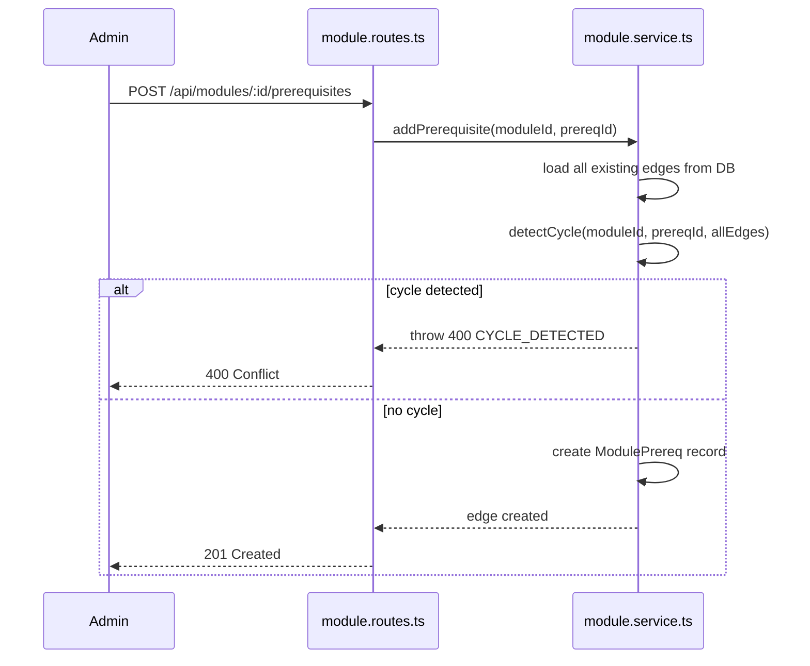
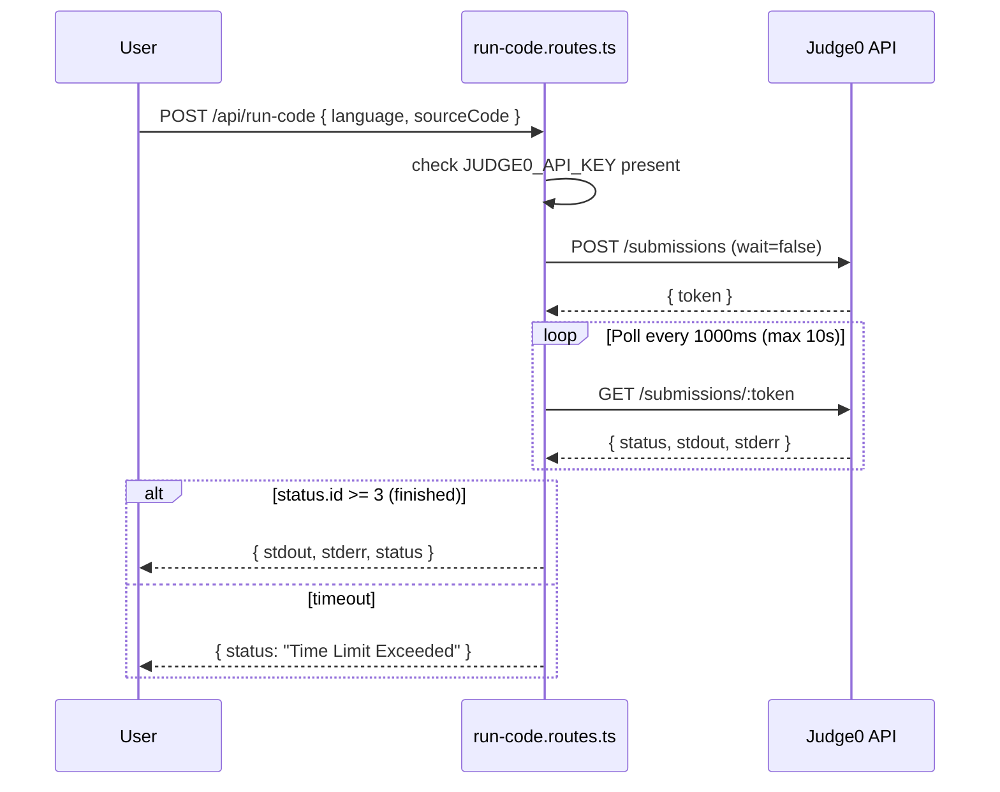
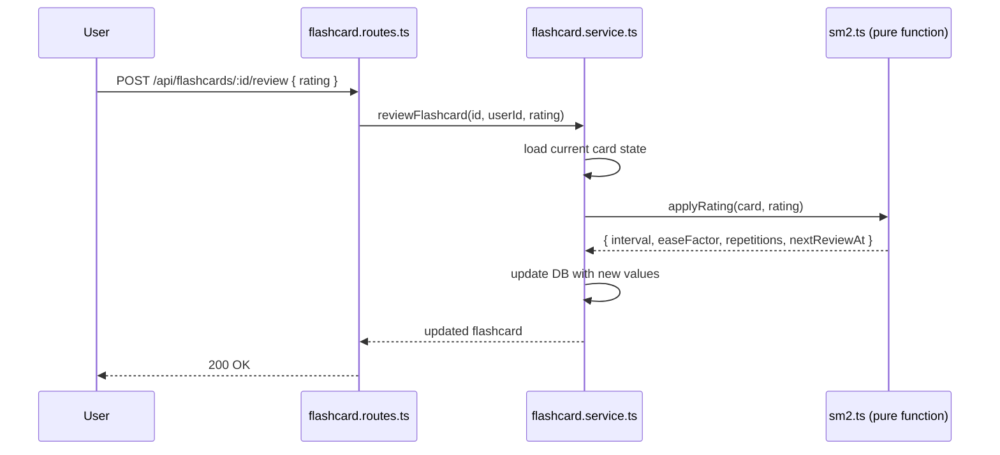

# Design Document

## Stage 3 Learning System — Personal Everything Website

---

## Overview

Stage 3 memperkenalkan seksi paling kompleks dari seluruh website. Tambahan arsitektur utama:

1. **Model data DAG** — Prerequisit module membentuk directed acyclic graph yang disimpan sebagai join table self-referencing; cycle detection dijalankan pada setiap penyisipan edge
2. **Sistem konten berbasis blok** — Konten module disimpan sebagai `contentJson` (JSON array); frontend merender via widget registry (open-closed principle: widget baru = satu file + satu entri registry)
3. **Judge0 proxy** — Endpoint backend memproxy eksekusi kode untuk menjaga API key tetap di sisi server; di-rate-limit per user
4. **Sistem anchor XPath** — Anotasi teks menyerialkan posisi DOM range ke string XPath untuk persistent re-highlighting
5. **Algoritma SM-2** — Penjadwalan flashcard diimplementasikan sebagai pure function, diuji terpisah dari database

Semua pola yang ada (layered architecture, generic comments, MarkdownRenderer, shadcn/ui) digunakan kembali tanpa modifikasi.

### Batasan Desain

- Tidak ada library frontend baru yang diperkenalkan kecuali `reactflow`, `dagre`, `mathjs`, `recharts`, `@uiw/react-codemirror`, dan paket bahasa CodeMirror yang diperlukan.
- Algoritma SM-2 diimplementasikan sebagai pure function di `backend/src/lib/sm2.ts` — dapat diuji sepenuhnya tanpa Prisma.
- Cycle detection diimplementasikan sebagai pure function yang diekspor dari `module.service.ts` — dapat diuji sepenuhnya tanpa database.
- Widget registry menggunakan pola open-closed: `ModuleDetailPage` tidak perlu dimodifikasi ketika widget baru ditambahkan.

---

## Architecture

### Alur Penambahan Prerequisit dengan Cycle Detection



### Alur Eksekusi Kode via Judge0



### Alur Review Flashcard SM-2



---

## Components and Interfaces

### Perubahan Skema Database

**Model baru: Module**

```prisma
model Module {
  id            String         @id @default(dbgenerated("gen_random_uuid()")) @db.Uuid
  title         String         @db.VarChar(200)
  slug          String         @unique @db.VarChar(220)
  summary       String         @db.VarChar(500)
  contentJson   Json           @map("content_json")
  status        String         @default("draft") @db.VarChar(10)
  publishedAt   DateTime?      @map("published_at") @db.Timestamptz()
  createdAt     DateTime       @default(now()) @map("created_at") @db.Timestamptz()
  updatedAt     DateTime       @default(now()) @updatedAt @map("updated_at") @db.Timestamptz()
  prerequisites ModulePrereq[] @relation("ModulePrereqs")
  dependents    ModulePrereq[] @relation("ModuleDependents")
  pathModules   PathModule[]
  progress      UserProgress[]
  notes         UserNote[]
  @@index([status])
  @@index([slug])
  @@map("modules")
}
```

**Model baru: ModulePrereq**

```prisma
model ModulePrereq {
  moduleId       String @map("module_id") @db.Uuid
  prerequisiteId String @map("prerequisite_id") @db.Uuid
  module         Module @relation("ModulePrereqs", fields: [moduleId], references: [id], onDelete: Cascade)
  prerequisite   Module @relation("ModuleDependents", fields: [prerequisiteId], references: [id], onDelete: Cascade)
  @@id([moduleId, prerequisiteId])
  @@map("module_prereqs")
}
```

**Model baru: LearningPath**

```prisma
model LearningPath {
  id          String       @id @default(dbgenerated("gen_random_uuid()")) @db.Uuid
  title       String       @db.VarChar(200)
  description String?      @db.Text
  createdAt   DateTime     @default(now()) @map("created_at") @db.Timestamptz()
  modules     PathModule[]
  @@map("learning_paths")
}
```

**Model baru: PathModule**

```prisma
model PathModule {
  pathId   String       @map("path_id") @db.Uuid
  moduleId String       @map("module_id") @db.Uuid
  order    Int
  path     LearningPath @relation(fields: [pathId], references: [id], onDelete: Cascade)
  module   Module       @relation(fields: [moduleId], references: [id], onDelete: Cascade)
  @@id([pathId, moduleId])
  @@map("path_modules")
}
```

**Model baru: UserProgress**

```prisma
model UserProgress {
  userId      String   @map("user_id") @db.Uuid
  moduleId    String   @map("module_id") @db.Uuid
  completedAt DateTime @default(now()) @map("completed_at") @db.Timestamptz()
  user        User     @relation(fields: [userId], references: [id], onDelete: Cascade)
  module      Module   @relation(fields: [moduleId], references: [id], onDelete: Cascade)
  @@id([userId, moduleId])
  @@map("user_progress")
}
```

**Model baru: UserNote**

```prisma
model UserNote {
  id            String      @id @default(dbgenerated("gen_random_uuid()")) @db.Uuid
  userId        String      @map("user_id") @db.Uuid
  moduleId      String      @map("module_id") @db.Uuid
  highlightText String      @map("highlight_text") @db.Text
  anchorData    Json        @map("anchor_data")
  noteContent   String      @default("") @map("note_content") @db.Text
  createdAt     DateTime    @default(now()) @map("created_at") @db.Timestamptz()
  updatedAt     DateTime    @default(now()) @updatedAt @map("updated_at") @db.Timestamptz()
  user          User        @relation(fields: [userId], references: [id], onDelete: Cascade)
  module        Module      @relation(fields: [moduleId], references: [id], onDelete: Cascade)
  flashcards    Flashcard[]
  @@index([userId, moduleId])
  @@map("user_notes")
}
```

**Model baru: Flashcard**

```prisma
model Flashcard {
  id           String    @id @default(dbgenerated("gen_random_uuid()")) @db.Uuid
  userId       String    @map("user_id") @db.Uuid
  noteId       String?   @map("note_id") @db.Uuid
  front        String    @db.Text
  back         String    @db.Text
  nextReviewAt DateTime  @default(now()) @map("next_review_at") @db.Timestamptz()
  interval     Int       @default(1)
  easeFactor   Float     @default(2.5) @map("ease_factor")
  repetitions  Int       @default(0)
  createdAt    DateTime  @default(now()) @map("created_at") @db.Timestamptz()
  user         User      @relation(fields: [userId], references: [id], onDelete: Cascade)
  note         UserNote? @relation(fields: [noteId], references: [id], onDelete: SetNull)
  @@index([userId, nextReviewAt])
  @@map("flashcards")
}
```

### Endpoint API

**Modules**

| Method | Path | Auth | Deskripsi |
|--------|------|------|-----------|
| GET | `/api/modules` | JWT (any) | Semua published module + edge + status penyelesaian |
| GET | `/api/modules/:slug` | JWT (any) | Satu module lengkap dengan contentJson + status penyelesaian |
| POST | `/api/modules` | Admin | Buat module |
| PUT | `/api/modules/:id` | Admin | Update module |
| PATCH | `/api/modules/:id/publish` | Admin | Publish module |
| PATCH | `/api/modules/:id/unpublish` | Admin | Unpublish module |
| DELETE | `/api/modules/:id` | Admin | Hapus module |
| POST | `/api/modules/:id/prerequisites` | Admin | Tambah prerequisit edge (dengan cycle detection) |
| DELETE | `/api/modules/:id/prerequisites/:prereqId` | Admin | Hapus prerequisit edge |
| POST | `/api/modules/:id/complete` | JWT | Tandai module selesai |
| DELETE | `/api/modules/:id/complete` | JWT | Batalkan penandaan selesai |

Respons `GET /api/modules`:

```json
{
  "modules": [
    { "id": "uuid", "title": "Propositional Logic", "slug": "propositional-logic",
      "summary": "...", "status": "published", "completedAt": "2026-01-01T00:00:00Z" }
  ],
  "edges": [
    { "from": "prereq-module-id", "to": "module-id" }
  ]
}
```

**Learning Paths**

| Method | Path | Auth | Deskripsi |
|--------|------|------|-----------|
| GET | `/api/paths` | JWT (any) | Semua path beserta ordered module list + status penyelesaian |
| POST | `/api/paths` | Admin | Buat path |
| PUT | `/api/paths/:id` | Admin | Update title/description |
| DELETE | `/api/paths/:id` | Admin | Hapus path |
| PUT | `/api/paths/:id/modules` | Admin | Ganti seluruh ordered module list |

**Code Execution**

| Method | Path | Auth | Deskripsi |
|--------|------|------|-----------|
| POST | `/api/run-code` | JWT | Proxy ke Judge0 |

Request: `{ "language": "python", "sourceCode": "print('hello')", "stdin": "" }`
Response: `{ "stdout": "hello\n", "stderr": "", "status": "Accepted" }`

Pemetaan bahasa ke Judge0 ID di `backend/src/lib/judge0.ts`: python=71, typescript=74, java=62, csharp=51, haskell=61, rust=73, r=80.

Polling Judge0: POST ke submissions (wait=false) → dapatkan token → polling setiap 1000ms sampai status.id >= 3 → timeout setelah 10 detik.

Rate limiter dikeykan berdasarkan user ID (bukan IP): `keyGenerator: (req) => req.user!.id`, maks 20 per 60 detik.

**Notes**

| Method | Path | Auth | Deskripsi |
|--------|------|------|-----------|
| POST | `/api/notes` | JWT | Buat catatan |
| GET | `/api/notes?moduleId=` | JWT | Semua catatan user untuk sebuah module |
| PUT | `/api/notes/:id` | JWT | Update noteContent (hanya pemilik, 403 jika bukan) |
| DELETE | `/api/notes/:id` | JWT | Hapus catatan (hanya pemilik, 403 jika bukan) |

Shape `anchorData` yang disimpan di DB:

```json
{
  "startXPath": "/div[1]/p[2]/text()[1]",
  "startOffset": 14,
  "endXPath": "/div[1]/p[2]/text()[1]",
  "endOffset": 31
}
```

XPath bersifat relatif terhadap element container konten module (bukan document root).

**Flashcards**

| Method | Path | Auth | Deskripsi |
|--------|------|------|-----------|
| POST | `/api/flashcards` | JWT | Buat flashcard |
| GET | `/api/flashcards` | JWT | Semua flashcard user |
| GET | `/api/flashcards/review` | JWT | Flashcard yang jatuh tempo (nextReviewAt <= now) |
| POST | `/api/flashcards/:id/review` | JWT | Submit rating, terapkan SM-2 |
| DELETE | `/api/flashcards/:id` | JWT | Hapus flashcard |

### Komponen dan Arsitektur Frontend

**Widget Registry**

Lokasi: `frontend/src/components/learning/widgets/registry.tsx`

```tsx
export type BlockData = Record<string, unknown>;
export interface WidgetProps { data: BlockData }
export const widgetRegistry: Record<string, ComponentType<WidgetProps>> = {};
export function registerWidget(type: string, component: ComponentType<WidgetProps>) {
  widgetRegistry[type] = component;
}
```

Setiap file widget memanggil `registerWidget` di level module. `ModuleDetailPage` mengimpor semua file widget (memicu registrasi sebagai side effect). Menambah widget baru = buat file + satu import di `ModuleDetailPage`. Tipe blok yang tidak dikenal merender fallback yang tidak crash.

**Layout Graf React Flow**

Layout DAG otomatis via library `dagre`. Node diposisikan menggunakan `dagre.layout()` dengan `rankdir: 'TB'`, `nodesep: 60`, `ranksep: 80`. Setiap node berukuran 180×60 px.

Warna penyelesaian node: gray (muted) = belum selesai; green = selesai.
Highlight path: outline `ring-2 ring-primary` pada node yang termasuk path yang dipilih.

**Evaluasi Ekspresi SliderVizBlock**

Menggunakan `mathjs` `compile` + `evaluate` — tidak pernah menggunakan `eval()`.

```ts
import { compile } from 'mathjs';
const expr = compile(data.equation); // contoh: "a*sin(b*x)+c"
const points = xValues.map(x => ({
  x,
  y: expr.evaluate({ ...currentParamValues, x })
}));
```

Rentang x: -10 hingga 10, 200 sample point. Chart me-render ulang live saat slider berubah via controlled state.

**Utilitas Anchor XPath**

Lokasi: `frontend/src/utils/anchorUtils.ts`

Fungsi-fungsi utama:
- `getXPath(node: Node, container: Element): string` — XPath posisional relatif terhadap container (contoh: `/div[1]/p[2]/text()[1]`)
- `getNodeByXPath(xpath: string, container: Element): Node | null`
- `serializeRange(range: Range, container: Element): AnchorData`
- `deserializeRange(anchor: AnchorData, container: Element): Range | null`

Re-highlighting saat module dimuat: untuk setiap catatan, `deserializeRange` → jika valid, bungkus range dalam `<mark data-note-id="...">`. Bersihkan mark yang ada sebelum me-re-apply (idempotent). Gunakan `range.surroundContents(mark)` untuk kasus sederhana; fallback ke `extractContents` + wrap untuk range yang mencakup beberapa node.

**Arsitektur NotesPanel dan Selection Popup**

```
ModuleDetailPage
├── <div ref={contentRef}> (semua widget block dirender di sini)
│   └── useTextSelection(contentRef) → { selectedRange, clearSelection }
├── SelectionPopup (shadcn Popover yang ditautkan dekat seleksi)
│   └── Saat simpan: serializeRange → POST /api/notes → clearSelection → invalidate query
├── NotesPanel (shadcn Sheet)
│   └── NoteItem × N → klik → deserializeRange → scrollIntoView
└── Efek re-highlight berjalan saat data query catatan berubah
```

**Card Flip FlashcardsPage**

CSS 3D transform: `.card-container { perspective: 1000px }`, `.card-inner { transform-style: preserve-3d; transition: transform 0.4s }`, `.card-inner.flipped { transform: rotateY(180deg) }`, `.card-back { transform: rotateY(180deg); backface-visibility: hidden }`.

Diimplementasikan dengan Tailwind di mana memungkinkan; CSS custom diperlukan untuk `backface-visibility` dan `preserve-3d` (tidak ada di default Tailwind).

---

## Data Models

### Ringkasan Model dan Migrasi

| Model | Migrasi | Relasi Utama |
|---|---|---|
| Module | add_learning_core | self-join via ModulePrereq |
| ModulePrereq | add_learning_core | (moduleId, prerequisiteId) composite PK |
| LearningPath | add_learning_core | has many PathModule |
| PathModule | add_learning_core | (pathId, moduleId) composite PK, memiliki order |
| UserProgress | add_learning_core | (userId, moduleId) composite PK |
| UserNote | add_user_notes | FK ke Module + User; has many Flashcard |
| Flashcard | add_flashcards | FK ke UserNote (nullable) + User |

UserProgress dan Flashcard cascade-delete saat User parent dihapus.
UserNote cascade-delete saat Module dihapus.
`Flashcard.noteId` di-SET NULL saat UserNote dihapus (flashcard tetap ada).

### Konfigurasi yang Relevan

| Variabel | Deskripsi |
|---|---|
| `JUDGE0_API_URL` | URL base Judge0 REST API |
| `JUDGE0_API_KEY` | API key Judge0; tidak ada = 503 CODE_EXECUTION_UNAVAILABLE |
| `DATABASE_URL` | Tidak berubah dari Stage 1 dan 2 |

---

## Correctness Properties

*A property is a characteristic or behavior that should hold true across all valid executions of a system — essentially, a formal statement about what the system should do. Properties serve as the bridge between human-readable specifications and machine-verifiable correctness guarantees.*

### Property S3-1: DAG Cycle Prevention

*For any* urutan penyisipan prerequisit edge yang akan membentuk siklus, setiap penyisipan semacam itu ditolak dengan 400 `CYCLE_DETECTED`. Graf tetap merupakan DAG yang valid setelah sembarang urutan penyisipan yang valid.

**Validates: Requirements 2.5**

### Property S3-2: SM-2 Ease Factor Bounds

*For any* urutan rating yang diterapkan pada sebuah flashcard, `easeFactor` tidak pernah turun di bawah 1.3.

**Validates: Requirements 8.5**

### Property S3-3: SM-2 Interval Monotonicity for Good/Easy Ratings

*For any* rating 3 atau 4 yang diterapkan secara berturut-turut dengan `repetitions >= 2`, interval bersifat non-decreasing.

**Validates: Requirements 8.5**

### Property S3-4: XPath Round-Trip Fidelity

*For any* text range dalam container konten module, `serializeRange` kemudian `deserializeRange` menghasilkan range dengan start/end node dan offset yang identik.

**Validates: Requirements 7.10**

### Property S3-5: Note Ownership Enforcement

*For any* catatan yang dimiliki user A, `PUT` dan `DELETE` dengan token user B mengembalikan 403.

**Validates: Requirements 7.4, 7.5**

### Property S3-6: Code Execution Rate Limit

*For any* window 60 detik, request ke-21 ke `POST /api/run-code` dari user yang sama mengembalikan 429, terlepas dari hasil request sebelumnya.

**Validates: Requirements 6.4**

---

## Error Handling

### Cycle Detected

`detectCycle` melakukan BFS dari prerequisit yang diusulkan, mengikuti edge yang ada ke depan. Jika module yang memulai dapat dicapai, edge tersebut akan menciptakan siklus. Service memuat semua edge yang ada sebelum memanggil fungsi ini. O(V+E) per penyisipan — dapat diterima pada skala personal site.

### Draft Module 404

`getModuleBySlug` memeriksa `status === 'published'`; throw 404 jika draft atau tidak ditemukan — keberadaan draft tidak pernah terekspos kepada non-admin user.

### Judge0 API Key Tidak Ada

Jika `JUDGE0_API_KEY` tidak ada di environment, handler `/api/run-code` langsung mengembalikan 503 `CODE_EXECUTION_UNAVAILABLE` tanpa memanggil Judge0.

### Judge0 Polling Timeout

Jika setelah 10 detik status Judge0 belum >= 3 (finished), backend menghentikan polling dan mengembalikan `{ status: "Time Limit Exceeded", stdout: "", stderr: "" }`.

### Note Ownership Violation

Sebelum setiap operasi `PUT` atau `DELETE` pada `UserNote`, service memuat catatan dari DB dan memverifikasi `userId === currentUser.id`. Jika tidak cocok, throw 403.

### SM-2 EaseFactor Floor

`applyRating` selalu menegakkan `easeFactor = Math.max(1.3, easeFactor)` setelah setiap kalkulasi rating 2. Jaminan ini berlaku selamanya berkat sifat komposisional fungsi pure.

### Flashcard Not Found / Wrong Owner

Service `reviewFlashcard` dan `deleteFlashcard` memverifikasi bahwa flashcard ada dan `userId` cocok; throw 404 jika tidak ada, throw 403 jika owner salah.

---

## Testing Strategy

### Pendekatan Pengujian Ganda

Stage 3 menggunakan kombinasi unit tests, integration tests, component tests, dan property-based tests untuk cakupan komprehensif.

### Unit Tests

- `detectCycle`: tidak ada siklus pada chain sederhana; mendeteksi siklus langsung (A→B, tambah B→A); mendeteksi siklus tidak langsung (A→B→C, tambah C→A)
- `applyRating` (SM-2): rating 1 → interval reset ke 1, repetitions reset ke 0; rating 3 pada 0 reps → interval 1; rating 3 pada 2 reps → interval = round(prev * easeFactor); rating 4 → easeFactor bertambah 0.1; easeFactor tidak pernah turun di bawah 1.3
- `serializeRange` → `deserializeRange` round-trip: pada mock DOM tree, serialisasi dan deserialisasi menghasilkan range dengan start/end node dan offset yang sama
- `getXPath` mengembalikan string XPath valid yang dapat di-resolve `getNodeByXPath` kembali ke node yang sama

### Integration Tests

- Buat dua module, tambah prerequisit edge → `GET /api/modules` mengembalikan edge; tambah edge balik → 400 `CYCLE_DETECTED`
- `POST /api/modules/:id/complete` → 201; panggil kedua → 409; `DELETE` → 204; `DELETE` lagi → 404
- `GET /api/paths` mengembalikan path beserta ordered module + status penyelesaian
- Publish module → `GET /api/modules` menyertakannya; unpublish → dihapus dari daftar
- Komentar dengan `contentType: 'module'` → 201
- `POST /api/run-code` dengan mocked Judge0 response — mengembalikan stdout yang benar
- Bahasa yang tidak didukung → 400; `JUDGE0_API_KEY` tidak ada → 503; request ke-21 dalam 1 menit dari user yang sama → 429
- Buat catatan → `GET /api/notes?moduleId=` mengembalikannya
- User A tidak dapat update/delete catatan user B → 403
- Hapus module → cascade ke catatan
- Buat flashcard dari catatan → `front` default ke `highlightText`; `GET /review` mengembalikannya; submit rating 3 → `nextReviewAt` maju sesuai interval; submit rating 1 → interval reset
- `GET /api/admin/stats` mengembalikan semua counter termasuk `totalModules`

### Component Tests (Frontend)

- `MarkdownBlock` dengan `data.content = "# Hello $x^2$"` → merender heading + KaTeX span
- `FillBlankBlock` — jawaban benar → badge hijau; jawaban salah → badge merah; jawaban tidak diungkap
- `SliderVizBlock` — mengubah nilai slider memperbarui data chart (cek prop `data` recharts)
- Tipe blok yang tidak dikenal merender fallback tanpa throw
- `ModuleDetailPage` — tombol "Mark as Complete" memanggil API; menjadi disabled setelah berhasil
- Diberikan 3 mock module dengan 2 edge, React Flow merender 3 node dan 2 edge
- Node module yang selesai memiliki class hijau; yang belum selesai memiliki class muted
- Memilih path hanya menyorot node module dari path tersebut
- User yang tidak terotentikasi diarahkan ke `/login`
- Selection popup muncul setelah mock `mouseup` dengan seleksi; Save memanggil `POST /api/notes`; Cancel membersihkan state
- `NotesPanel` — mengklik catatan memanggil `scrollIntoView`; hapus menampilkan AlertDialog
- Block editor (ModuleEditorPage): menambah markdown block menambahkannya ke daftar; drag mengubah urutan; hapus menghapusnya
- Prereq selector: memilih module menambahkannya sebagai chip; menghapusnya menghilangkan chip; cycle error dari API merender inline error alert
- Path editor: menambah module ke sekuens memperbarui daftar; drag mengubah urutan; save memanggil API dengan urutan yang benar
- `FlashcardsPage`: hanya menampilkan sisi depan awalnya; "Reveal" menampilkan sisi belakang dan tombol rating
- Tombol rating memanggil API dengan rating yang benar; maju ke kartu berikutnya
- Ketika daftar review kosong, pesan "All done!" ditampilkan; badge jumlah kartu jatuh tempo menampilkan angka yang benar
- Dashboard merender stat card `totalModules` dengan nilai yang benar dari mock data
- Landing page Learning CTA menampilkan tombol "Explore Learning" untuk user terotentikasi; "Sign up to access" untuk visitor

### Property-Based Tests (fast-check, minimum 100 iterasi)

- **Property S3-1**: DAG cycle prevention — untuk sembarang urutan penyisipan edge yang valid diikuti satu penyisipan yang menciptakan siklus, penyisipan terakhir ditolak dan graf tetap merupakan DAG yang valid (**Validates: Requirements 2.5**)
- **Property S3-2**: SM-2 ease factor bounds — untuk sembarang urutan rating yang diterapkan pada sebuah flashcard, `easeFactor` tidak pernah turun di bawah 1.3 (**Validates: Requirements 8.5**)
- **Property S3-3**: SM-2 interval monotonicity — untuk rating 3 atau 4 yang diterapkan berturut-turut dengan `repetitions >= 2`, interval bersifat non-decreasing (**Validates: Requirements 8.5**)
- **Property S3-4**: XPath round-trip fidelity — untuk sembarang text range dalam container konten module, serialize kemudian deserialize menghasilkan range yang identik (**Validates: Requirements 7.10**)
- **Property S3-5**: Note ownership enforcement — untuk sembarang catatan yang dimiliki user A, PUT dan DELETE dengan token user B selalu mengembalikan 403 (**Validates: Requirements 7.4, 7.5**)

Setiap property test menggunakan tag format: `Feature: stage-3-learning, Property {N}: {deskripsi singkat}`.
